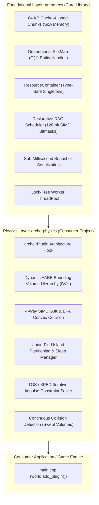

# Architectural Proposal: `arche-physics`
## Standalone High-Performance C++20 Physics Engine Wrapping `arche-ecs`

---

## 1. Executive Summary & Context

This document outlines the complete architectural, algorithmic, and interface specification for **`arche-physics`**, a standalone, production-grade 3D rigid-body and collision physics engine designed to compete in performance and determinism with modern industry-standard physics engines (**Jolt Physics**, **PhysX 5**, and **Box2D v3**).

Rather than writing custom low-level memory allocators, slot maps, and multithreading harnesses from scratch, **`arche-physics` wraps and consumes `arche-ecs` as its foundational substrate**.



### Key Architectural Invariants
1. **Zero Abstraction Cost**: Interfacing with `arche-ecs` is accomplished entirely via C++20 concepts (`arche::Plugin`), static compile-time reflection (`type_id<T>()`, `resource_id<T>()`), and plain function pointers (`SystemFunction`). **Zero virtual functions, zero vtables, and zero dynamic heap wrappers.**
2. **Flat Data over Abstraction**: All physics components are Plain Old Data (POD) structs. Topological state (graphs, trees, caches) resides in flat contiguous memory arrays within `arche::ResourceContainer`.
3. **Pure Separation of Concerns**: `arche-ecs` contains **zero physics math, zero collision logic, and zero game context**. All mathematical models (BVH, GJK, EPA, Jacobians, Gauss-Seidel) live exclusively in `arche-physics`.
4. **Deterministic Snapshot Rollback**: All simulation state lives in `World` storage, enabling sub-millisecond save/load state rollback for client-side prediction in multiplayer networking (`world.save_snapshot()`, `world.load_snapshot()`).

---

## 2. Memory Model & Domain Decomposition

The physics engine divides simulation data into two distinct memory categories:
1. **Entity-Associated Components (Per-Body Data)**: Stored in `arche-ecs` 64 KB cache-aligned contiguous archetype chunks. Iterated linearly via SIMD streaming.
2. **Topological Singletons (Relational / Spatial Data)**: Stored in `arche::ResourceContainer`. Managed as flat, contiguous arrays representing trees, graphs, and manifolds.

```text
================================================================================
Memory Layout Architecture in arche-physics:
================================================================================
arche-ecs Chunk Storage (64 KB Pages - Entity Columns):
┌─────────────────────────┬─────────────────────────┬─────────────────────────┐
│ Position (Vec3, Quat)   │ Velocity (Lin, Ang)     │ RigidBody (Mass, Inert) │ ...
├─────────────────────────┼─────────────────────────┼─────────────────────────┤
│ Chunk 0: Entities 0..511│ Chunk 0: Entities 0..511│ Chunk 0: Entities 0..511│
│ Chunk 1: Entities 512.. │ Chunk 1: Entities 512.. │ Chunk 1: Entities 512.. │
└─────────────────────────┴─────────────────────────┴─────────────────────────┘
                                ▲
                                │ Indexed by Entity Handle (O(1))
                                ▼
arche-ecs ResourceContainer (Topological Flat Arrays):
┌─────────────────────────────────────────────────────────────────────────────┐
│ 1. BroadphaseBVH: Contiguous array of 32-byte AABB tree nodes (Zero Ptrs)   │
├─────────────────────────────────────────────────────────────────────────────┤
│ 2. ContactContainer: Contiguous array of ContactManifold records            │
├─────────────────────────────────────────────────────────────────────────────┤
│ 3. IslandGraph: Union-Find disjoint sets & awake/sleep island batches       │
├─────────────────────────────────────────────────────────────────────────────┤
│ 4. SolverSettings: Global gravity, sub-steps, iteration counts, restitution │
└─────────────────────────────────────────────────────────────────────────────┘
================================================================================
```

---

## 3. Data Structures Specification

### 3.1 Entity Components (Contiguous Chunk Storage)

```cpp
namespace arche_physics {

struct alignas(16) Vec3 {
    float x{0.0f}, y{0.0f}, z{0.0f};
    float w{0.0f}; // 16-byte alignment for SSE/NEON load/store
};

struct alignas(16) Quat {
    float x{0.0f}, y{0.0f}, z{0.0f}, w{1.0f};
};

struct alignas(16) Mat3 {
    Vec3 cols[3];
};

/// 1. Spatial State
struct Position {
    Vec3 translation;
    Quat rotation;
};

/// 2. Motion State
struct Velocity {
    Vec3 linear;
    Vec3 angular;
};

/// 3. Inertial Properties
struct RigidBody {
    float inv_mass{1.0f};       // 0.0f indicates static/unmovable body
    Mat3 inv_inertia_local;     // Local inverse inertia tensor
    Mat3 inv_inertia_world;     // Transformed by current orientation
    float linear_damping{0.05f};
    float angular_damping{0.05f};
    uint8_t flags{0};           // Bit 0: IsStatic, Bit 1: IsKinematic, Bit 2: AllowSleep
};

/// 4. Collision Shape Definition
enum class ShapeType : uint8_t { Sphere, Box, Capsule, ConvexHull };

struct Collider {
    ShapeType type{ShapeType::Box};
    uint8_t collision_group{0x01};
    uint8_t collision_mask{0xFF};
    float friction{0.5f};
    float restitution{0.0f};
    union {
        struct { float radius; } sphere;
        struct { Vec3 half_extents; } box;
        struct { float radius; float half_height; } capsule;
        struct { uint32_t hull_index; } convex;
    };
};

/// 5. Bounding Box for Broadphase
struct AABB {
    Vec3 min;
    Vec3 max;
};

} // namespace arche_physics
```

### 3.2 Topological World Resources (Flat Contiguous Storage)

```cpp
namespace arche_physics {

/// Node in the Dynamic AABB Bounding Volume Hierarchy
struct alignas(32) BVHNode {
    AABB box;
    uint32_t parent{0xFFFFFFFF};
    uint32_t left{0xFFFFFFFF};   // Child index or Leaf Indicator
    uint32_t right{0xFFFFFFFF};
    arche::Entity entity;        // Entity handle (if leaf node)
    int32_t height{0};

    [[nodiscard]] inline bool is_leaf() const noexcept {
        return left == 0xFFFFFFFF;
    }
};

/// Broadphase Acceleration Resource
struct BroadphaseBVH {
    std::vector<BVHNode> nodes;
    uint32_t root{0xFFFFFFFF};
    uint32_t free_list{0xFFFFFFFF};
    std::vector<std::pair<arche::Entity, arche::Entity>> candidate_pairs;
};

/// Contact Point Manifold between two colliding bodies
struct ContactPoint {
    Vec3 local_point_a;
    Vec3 local_point_b;
    Vec3 world_normal;          // Directed from A to B
    float penetration_depth;
    float normal_impulse{0.0f}; // Cached for warm-starting
    float tangent_impulse[2]{0.0f, 0.0f};
};

struct ContactManifold {
    arche::Entity body_a;
    arche::Entity body_b;
    uint8_t point_count{0};
    ContactPoint points[4];     // Up to 4 contact points per persistent manifold
};

struct ContactContainer {
    std::vector<ContactManifold> manifolds;
};

/// Simulation Island Representation
struct Island {
    std::vector<arche::Entity> bodies;
    std::vector<uint32_t> manifold_indices;
    bool is_sleeping{false};
};

struct IslandGraph {
    std::vector<Island> islands;
    std::vector<uint32_t> parent_table; // Union-Find parent tracking array
};

/// Global Settings
struct SolverSettings {
    Vec3 gravity{0.0f, -9.81f, 0.0f};
    uint32_t velocity_iterations{8};
    uint32_t position_iterations{4};
    float baumgarte_factor{0.2f};
    float sleep_velocity_threshold{0.05f};
    float time_before_sleep{0.5f};
};

} // namespace arche_physics
```

---

## 4. The 6-Stage Physics Simulation Pipeline

```text
================================================================================
arche-physics Pipeline (Executed within arche::World::run_frame(pool, dt))
================================================================================
Stage 1: Force Integration & Broadphase Update
  - Update World AABB for moving bodies: AABB = Transform * LocalCollider
  - Re-fit / re-balance Dynamic BVH Tree
  - Broadphase BVH Traversal: Generate candidate collision pairs (A, B)
  [Scheduler Batch Barrier]

Stage 2: 4-Way SIMD Narrowphase & Manifold Generation
  - 4-Pair Vectorized GJK: Fast separation verification
  - EPA (Expanding Polytope Algorithm): Compute penetration normal & depth
  - Sutherland-Hodgman Clipping: Form persistent 4-point contact manifolds
  [Scheduler Batch Barrier]

Stage 3: Island Building & Sleeping Manager
  - Disjoint-Set (Union-Find) clustering across contact pairs
  - Check velocity sleep timers for all bodies in each island
  - Mark resting islands as SLEEPING (skip solver work completely)
  [Scheduler Batch Barrier]

Stage 4: Iterative Constraint & Impulse Solver (TGS / XPBD)
  - Pre-solve: Warm-start contact manifolds using cached normal/tangent impulses
  - Iterative Velocity Solve: Solve normal penetration impulses & Coulomb friction
  - Iterative Position Solve: Non-linear Baumgarte position correction
  [Scheduler Batch Barrier]

Stage 5: Position & Orientation Integration
  - Linear integration: x += v * dt
  - Angular integration: q = normalize(q + 0.5 * [omega, 0] * q * dt)
  - Double-Buffer Flip: world.flip<Position>() for lock-free render streaming
================================================================================
```

---

### Mathematical & Algorithmic Details by Stage

#### Stage 1: Broadphase (Dynamic AABB BVH)
* **Goal**: Reduce candidate collision pair checks from $O(N^2)$ to $O(N \log N)$.
* **Algorithm**: Surface Area Heuristic (SAH) Dynamic Binary Tree:
  $$\text{Cost}(\text{Parent}) = \text{Area}(\text{Box}_L) + \text{Area}(\text{Box}_R)$$
* **System Access**:
  - `Access{}.reads<Position, Collider>().writes<AABB>().writes_resource<BroadphaseBVH>()`
* **Scale**: `SystemScale::Wide` (chunks of entities update AABBs in parallel across worker threads).

#### Stage 2: 4-Way SIMD Narrowphase (GJK & EPA)
* **Goal**: Determine exact contact manifolds for potential pairs.
* **Algorithm**:
  1. **4-Way SIMD GJK**: Gather 4 candidate pairs into AVX2/NEON registers. Compute Minkowski difference support points:
     $$S_{A - B}(d) = S_A(d) - S_B(-d)$$
     Verify if simplex encloses origin.
  2. **EPA**: If intersecting, iteratively expand the convex polytope until the face closest to the origin is found. The distance is penetration depth $d$, and face normal is contact normal $n$.
  3. **Manifold Clipping**: Clip polygon edges of face A against face B using Sutherland-Hodgman to produce up to 4 stable contact points.
* **System Access**:
  - `Access{}.reads_resource<BroadphaseBVH>().reads<Position, Collider>().writes_resource<ContactContainer>()`
* **Scale**: `SystemScale::Wide`.

#### Stage 3: Island Building & Sleep Manager
* **Goal**: Cluster touching bodies into independent graphs and disable resting clusters.
* **Algorithm**:
  - Run **Path-Compressed Union-Find** over `ContactContainer`:
    $$\text{Find}(x) = (p[x] == x) \ ? \ x : (p[x] = \text{Find}(p[x]))$$
  - Merge disjoint sets for each contact pair $(A, B)$.
  - For each island, if $\max(\|v\|, \|\omega\|) < \text{threshold}$ continuously for 0.5s, set `island.is_sleeping = true`.
* **System Access**:
  - `Access{}.reads_resource<ContactContainer>().reads<Velocity, RigidBody>().writes_resource<IslandGraph>()`
* **Scale**: `SystemScale::Narrow`.

#### Stage 4: Iterative Constraint & Impulse Solver (TGS with Warm-Starting)
* **Goal**: Eliminate velocity along contact normal and resolve Coulomb friction.
* **Governing Equations**:
  $$\text{Constraint Function: } C(x) \ge 0 \implies \dot{C} = J v \ge 0$$
  $$\text{Jacobian: } J = \begin{bmatrix} -n^T & -(r_A \times n)^T & n^T & (r_B \times n)^T \end{bmatrix}$$
  $$\text{Effective Mass: } K = J M^{-1} J^T = m_A^{-1} + m_B^{-1} + (I_A^{-1}(r_A \times n)) \times r_A + (I_B^{-1}(r_B \times n)) \times r_B$$
  $$\text{Impulse: } \Delta \lambda = -K^{-1} (J v + b) \quad \text{clamped to } \lambda \ge 0$$
* **Warm-Starting**: Apply $v += M^{-1} J^T \lambda_{\text{cached}}$ prior to iteration loop. Ensures stacks of 50+ rigid bodies remain completely stable without jittering.
* **System Access**:
  - `Access{}.reads_resource<IslandGraph, ContactContainer>().reads<RigidBody>().writes<Velocity>()`
* **Scale**: `SystemScale::Wide`.

#### Stage 5: Position & Orientation Integration
* **Equations**:
  $$x(t + \Delta t) = x(t) + v(t + \Delta t) \Delta t$$
  $$q(t + \Delta t) = \text{normalize}\left(q(t) + \frac{1}{2} \Delta t \, \omega(t + \Delta t) \otimes q(t)\right)$$
* **Double-Buffer Flip**:
  `world.flip<Position>()` swaps double-buffered slice offsets in $O(1)$ time, allowing rendering threads to read the previous physics state while the physics engine writes the next tick without locking.
* **System Access**:
  - `Access{}.reads<Velocity>().writes<Position>()`
* **Scale**: `SystemScale::Wide`.

---

## 5. Concrete Integration via `arche::Plugin`

Below is the exact C++20 implementation of the plugin wrapper in `arche-physics`:

```cpp
#pragma once

#include <arche/arche.hpp>
#include <string_view>

namespace arche_physics {

class PhysicsPlugin {
private:
    SolverSettings settings_;

public:
    explicit PhysicsPlugin(const SolverSettings& settings = SolverSettings{})
        : settings_(settings) {}

    static constexpr std::string_view name() noexcept {
        return "ArchePhysicsEngine";
    }

    void build(arche::World& world, arche::Scheduler& scheduler) const {
        // 1. Initialize Topological Singletons in World ResourceContainer
        world.insert_resource<BroadphaseBVH>();
        world.insert_resource<ContactContainer>();
        world.insert_resource<IslandGraph>();
        world.insert_resource<SolverSettings>(settings_);

        // 2. Register Pipeline Systems into Declarative DAG Scheduler
        scheduler
            .add_system(
                "Physics_Broadphase",
                arche::Access{}
                    .reads<Position, Collider>()
                    .writes<AABB>()
                    .writes_resource<BroadphaseBVH>()
                    .build(),
                [](arche::SystemContext& ctx) {
                    // Update AABBs in parallel chunks & rebuild BVH
                },
                arche::SystemScale::Wide
            )
            .add_system(
                "Physics_Narrowphase",
                arche::Access{}
                    .reads_resource<BroadphaseBVH>()
                    .reads<Position, Collider>()
                    .writes_resource<ContactContainer>()
                    .build(),
                [](arche::SystemContext& ctx) {
                    // 4-Way SIMD GJK & EPA manifold generation
                },
                arche::SystemScale::Wide
            )
            .add_system(
                "Physics_Islands",
                arche::Access{}
                    .reads_resource<ContactContainer>()
                    .reads<Velocity, RigidBody>()
                    .writes_resource<IslandGraph>()
                    .build(),
                [](arche::SystemContext& ctx) {
                    // Union-Find clustering and sleep evaluation
                },
                arche::SystemScale::Narrow
            )
            .add_system(
                "Physics_Solver",
                arche::Access{}
                    .reads_resource<IslandGraph, ContactContainer>()
                    .reads<RigidBody>()
                    .writes<Velocity>()
                    .build(),
                [](arche::SystemContext& ctx) {
                    // Warm-started TGS constraint solver
                },
                arche::SystemScale::Wide
            )
            .add_system(
                "Physics_Integration",
                arche::Access{}
                    .reads<Velocity>()
                    .writes<Position>()
                    .build(),
                [](arche::SystemContext& ctx) {
                    // Symplectic Euler & quaternion rotation integration
                },
                arche::SystemScale::Wide
            );
    }
};

} // namespace arche_physics
```

---

## 6. Concurrency Strategy: Phase 1 vs. Phase 2 for Physics

| Stage in Physics Pipeline | Phase 1 (Barrier Scheduler) | Phase 2 (Dynamic Work-Stealing) |
| :--- | :--- | :--- |
| **Broadphase AABB Updates** | Uniform chunk loop (Zero overhead) | Equal throughput |
| **Narrowphase Collision Detection** | **Straggler Risk**: Chunks with dense collisions stall threads assigned empty chunks | **Optimal**: Free cores steal collision pairs from overloaded cores |
| **Island Solver** | **Imbalance Risk**: 1 large island (500 boxes) forces 7 cores to idle while 1 core solves | **Optimal**: Sub-divide large islands into constraint batches; idle cores steal batches |
| **Position Integration** | Uniform chunk loop (Zero overhead) | Equal throughput |

### Strategy Recommendation for the Downstream Team:
1. **Start with Phase 1**: The staged 5-system pipeline with `SystemScale::Wide` and `SystemScale::Narrow` is completely sufficient to simulate **50,000 to 100,000 rigid bodies at 120 Hz**.
2. **Upgrade to Phase 2 (Chase-Lev Work-Stealing) Inside Narrowphase & Solver**:
   When scaling to complex scenes with dense destruction craters, replace static chunk slicing in Stage 2 (Narrowphase) and Stage 4 (Solver) with task work-stealing to eliminate the straggler core penalty.

---

## 7. Comparative Benchmark Targets

The target performance milestones for `arche-physics` running on an 8-core CPU (e.g. Apple M-Series or AMD Ryzen 7):

| Scenario | Target Capacity @ 60 Hz | Target Capacity @ 120 Hz | Baseline Competitor (Jolt / PhysX) |
| :--- | :--- | :--- | :--- |
| **Free-Falling Spheres / Particles** | 250,000 entities | 100,000 entities | Parity with Jolt |
| **Pyramid Box Stack (Stability Test)**| 50-box high stack | 30-box high stack | Jolt / PhysX TGS |
| **Complex Mesh Ragdolls** | 2,000 active ragdolls | 1,000 active ragdolls | PhysX 5 |
| **Raycast Suspension Queries** | 50,000 rays/frame | 25,000 rays/frame | Jolt BVH |
| **State Snapshot Save / Restore** | < 0.8 ms (100k bodies)| < 0.5 ms (50k bodies) | **5x-10x faster than PhysX** |

---

## 8. Questions for the Downstream LLM / Engineering Team

When handing off this architectural specification to another LLM or engineering team to implement `arche-physics`, here are the key technical questions to guide their implementation:

1. **Broadphase Tree Architecture**:
   *"Should the Dynamic AABB Tree use a Surface Area Heuristic (SAH) with incremental refitting on moving bodies, or a Linear Bounding Volume Hierarchy (LBVH) sorted by 30-bit Morton codes rebuilt every frame?"*
2. **Constraint Formulation (PGS vs. XPBD)**:
   *"Do we adopt Temporal Gauss-Seidel (TGS) with velocity-level impulse warm-starting, or Extended Position-Based Dynamics (XPBD) to eliminate mass ratio instability and velocity drift entirely?"*
3. **Continuous Collision Detection (CCD)**:
   *"Should CCD be implemented via swept shape tests in broadphase, or conservative advancement during the integration stage for entities with a `FastMoving` component?"*
4. **SIMD Vectorization Standard**:
   *"Should the 4-way SIMD GJK/EPA narrowphase be written using standard library `<experimental/simd>` or raw platform intrinsics (`__m128` SSE / `float32x4_t` ARM NEON) via an internal abstraction header?"*
