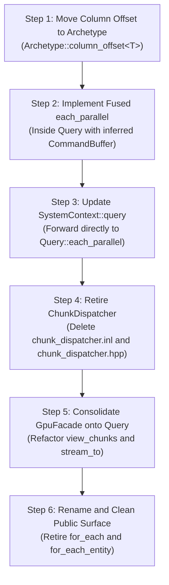

# Arche ECS — Unified Query Architecture & Iteration Specification

> **Document Status:** Architectural Proposal & Unified Design Specification  
> **Target:** Stage 1 / Stage 2 Evolution for `arche-ecs` C++20 Archetype ECS  
> **Directives Compliance:** Zero virtual methods, no RTTI, flat Data-Oriented Design (DOD), SIMD tail-padded columns, contiguous 64 KB memory chunks.

---

## 1. Executive Summary & Vision

In `arche-ecs`, a **Query** is not merely a user-facing helper for looping over entities—it is the **primary computational engine** of the entire library. 

Currently, iteration logic over archetypes and memory chunks is fragmented across:
1. `Query` (sequential visitors and iterators),
2. `ChunkDispatcher` (parallel work-stealing loops),
3. `SystemContext` (system scheduler execution),
4. `GpuFacade` (graphics reflection and column streaming),
5. `SnapshotFacade` (binary serialization),
6. `spatial::sort` (radix and comparator-based archetype sorting).

This fragmentation caused duplicated traversal loops, redundant prefetching logic, filter stripping during parallel dispatch, and unnecessary linear archetype scans.

### The Unified Query Philosophy
> **"Define Once, Compile-Time Specialize, Execute at Hardware Granularity."**

A single unified iteration pipeline must govern all traversals across the engine:
* **One Core Search Engine:** Archetype bitmask matching with reactive $O(1)$ query caching.
* **One Chunk Traversal Pipeline:** Temporal version filtering (`Added`, `Mutated<T>`), lookahead cache prefetching (`ChunkHeader` + SoA columns), and empty-chunk skipping.
* **Unified Compile-Time Permission Model:** 
  - Mutability is inferred directly from standard C++ types: `const T` $\rightarrow$ Read-Only (`const T*`, clean chunk), `T` $\rightarrow$ Read-Write (`T*`, dirty tick bumped).
  - Optional presence: `const T*` / `Opt<const T>` $\rightarrow$ unswitched chunk/archetype branching.
  - Existence checks: `Has<T>` $\rightarrow$ zero-cost compile-time boolean flag.
  - Entity handle: `Entity` $\rightarrow$ contiguous `const Entity*` slice.
* **The 3 Canonical Execution Pillars:**
  1. **Scalar Entity Loop:** Standard C++20 structured bindings (`for (auto [pos, vel] : query)`). Supports native `break`, `continue`, and `return`. (Replaces and retires `for_each` and `for_each_entity`).
  2. **Batch Chunk Loop (`each_chunk`):** Single-threaded contiguous C arrays for automatic compiler vectorization.
  3. **Parallel Chunk Loop (`each_parallel`):** Multi-threaded work-stealing with **compile-time inferred `CommandBuffer`** injection.
  4. *(Expert Escape Hatch)* **SIMD Tail-Padded Loop (`each_chunk_padded`):** Unconditional AVX-512 / NEON vector bounds with zero scalar cleanup loops.

---

## 2. Comprehensive Audit of Existing Query & Iteration Functions

### 2.1 Public User-Facing APIs

| API Signature | Location | Purpose & Consumer Use Case | Return / Callback Type |
| :--- | :--- | :--- | :--- |
| `world.query<Components...>(filters...)` | `include/arche/world.hpp` | Primary factory method. Resolves cache, registers types, builds bitmasks. | `Query<Components...>` |
| `Query<Components...>(World&, filters...)` | `include/arche/query.hpp` | Direct query constructor supporting variadic filter tags. | `Query<Components...>` |
| `query.begin()`, `query.end()` | `include/arche/query.hpp` | C++17/20 range-based for loops: `for (auto [pos, vel] : query)`. | `QueryIterator<Components...>` |
| `query.for_each(fn)` | `include/arche/query.hpp` | **[REDUNDANT - RETIRE]** Scalar row visitor wrapping `begin()/end()`. Cannot `break` early. | `fn(Components&...)` |
| `query.for_each_entity(fn)` | `include/arche/query.hpp` | **[REDUNDANT - RETIRE]** Exposes `Entity`. Redundant with `query<Entity, ...>()`. | `fn(Entity, Components&...)` |
| `query.for_each_chunk(fn)` | `include/arche/query.hpp` | High-performance batch visitor. Contiguous pointers for auto-vectorization. | `fn(uint32_t count, Components*...)` |
| `query.for_each_chunk_padded(fn)` | `include/arche/query.hpp` | SIMD batch visitor exposing `padded_count = (count + 15) & ~15` for AVX/NEON loops. | `fn(uint32_t active, uint32_t padded, Components*...)` |
| `query.each_parallel(pool, fn)` | `include/arche/query.hpp` | Chunk-level work-stealing parallel execution across worker threads. | `fn(uint32_t count, Components*...)` |
| `query.each_parallel(pool, cmds, fn)` | `include/arche/query.hpp` | **[FUSE]** Parallel dispatch requiring manual `ParallelCommandBuffer`. | `fn(uint32_t count, CommandBuffer&, Components*...)` |
| `ctx.query_parallel<Comps...>(fn)` | `src/system/system_context.hpp`| Scheduler context helper inside Wide system execution callbacks. | `fn(uint32_t count, CommandBuffer&, Comps*...)` |
| `world.gpu.view_chunks<T>()` | `include/arche/contracts/gpu.hpp` | Reflects contiguous memory spans of component `T` for GPU buffers. | `std::vector<ComponentSpan<T>>` |
| `world.gpu.stream_to<T>(dst)` | `include/arche/contracts/gpu.hpp` | Blits all contiguous columns of `T` directly into destination memory. | `size_t` (total bytes written) |
| `world.archetypes.count_with<T>()` | `include/arche/contracts/archetype.hpp` | Introspection metric: counts entities possessing component `T`. | `uint32_t` |
| `arche::sort<T, Filters...>(w, comp)` | `src/spatial/sort.hpp` | Queries archetypes matching `T` + `Filters...` and sorts columns. | `void` |
| `arche::sort_by_key<T, Filters...>(w, key)`| `src/spatial/sort.hpp` | High-performance radix/comparator sort using extracted scalar key. | `void` |

---

### 2.2 Internal Traversal & Query Functions

| Function Signature | Location | Iterates Over | Architectural Role |
| :--- | :--- | :--- | :--- |
| `Query::matching_archetypes()` | `src/query/query.inl` | Archetypes | Resolves cached matching archetypes from `QueryCache` or evaluates `Or<...>` clauses. |
| `Query::get_chunks_for(arch)` | `src/query/query.inl` | Chunks | Forwards to `ChunkDistributor::get_archetype_chunks`. |
| `Query::chunk_matches_filters(chunk, arch)`| `src/query/query.inl` | Chunk Headers | Evaluates dirty ticks (`Mutated<T>`) and structure version (`Added`) in $O(1)$. |
| `Query::for_each_active_chunk(visitor)` | `src/query/query.inl` | Archetypes + Chunks | Core internal chunk loop: validates filters, prefetches next chunk, calls visitor. |
| `Query::resolve_column_offset<Comp>(arch)` | `src/query/query.inl` | Archetype Layout | Resolves byte offset inside chunk (0 for Entity, layout offset for T, 1/0 for Has). |
| `Query::get_column_ptr<Comp>(chunk, off)` | `src/query/query.inl` | Chunk Memory | Unpacks raw typed pointer `Comp*`, boolean for `Has<T>`, or `nullptr`. |
| `Query::get_column_pointers(chunk, arch)` | `src/query/query.inl` | Columns | Unpacks `std::tuple` of raw column pointers for a single chunk. |
| `Query::prefetch_next_chunk(...)` | `src/query/query.inl` | Hardware Cache | Emits CPU `__builtin_prefetch` on ChunkHeader and column slices. |
| `QueryIterator::advance_to_valid_chunk()` | `src/query/query_iterator.hpp`| Archetypes + Chunks | Traverses two-level hierarchy to position iterator at the next non-empty chunk. |
| `QueryIterator::load_chunk(chunk, arch)` | `src/query/query_iterator.hpp`| Chunk Layout | Caches column pointers and live entity count for inner row stepping. |
| `ChunkDispatcher::dispatch_parallel_chunks(...)`| `src/concurrency/chunk_dispatcher.inl`| Archetypes + Chunks | **[RETIRE]** Collects chunks into heap `std::vector` and runs atomic work stealing. |
| `GpuFacade::view_chunks<T>()` (internal body)| `src/world/world_facades_impl.hpp`| All Archetypes + Chunks| Linear search over `graph.archetypes()` testing `arch->column_index(tid) >= 0`. |
| `GpuFacade::stream_to<T>()` (internal body) | `src/world/world_facades_impl.hpp`| All Archetypes + Chunks| Linear search over `graph.archetypes()` copying contiguous memory spans. |
| `SnapshotFacade::save()` / `load()` | `src/world/world_facades.cpp` | All Archetypes + Chunks| Serializes/deserializes chunk buffers directly. |
| `ArchetypeGraph::create_archetype(...)` | `src/archetype/archetype_graph.hpp`| Registered Caches | Evaluates new archetypes against registered `QueryCache`s in $O(C)$ reactive matching. |

---

### 2.3 Critical Bottlenecks & Flaws in the Current Design

1. **Filter Stripping in Parallel Dispatch (`ChunkDispatcher`):**
   When `query.each_parallel(pool, fn)` was invoked, it delegated to `ChunkDispatcher`, which constructed a brand new `world.query<Components...>()`. This completely stripped all user-configured filters (`Without<TagDead>`, `Mutated<Transform>`, `Added`)!
2. **Duplicate Traversal Code:**
   In `query.inl`, `for_each_chunk` and `for_each_chunk_padded` manually wrote out the outer archetype loop, chunk lookup, dirty filter check, and lookahead prefetch. Meanwhile, `for_each_entity` and `ChunkDispatcher` called `for_each_active_chunk`.
3. **Linear Scans in `GpuFacade`:**
   `world.gpu.view_chunks<T>()` and `stream_to<T>()` performed an un-cached linear scan over every archetype in `world.archetypes()` rather than using the $O(1)$ `QueryCache`.
4. **API Proliferation & Redundancy:**
   Users were offered multiple overlapping scalar iteration options:
   - `for (auto [a, b] : q)`
   - `q.for_each(fn)`
   - `q.for_each_entity(fn)`
   `for_each` and `for_each_entity` are strictly inferior to C++20 structured bindings because they cannot use `break`, `continue`, or `return`.

---

## 3. The Unified Query Behavior Model

### 3.1 Permission & Const-Correctness Matrix

By inspecting types at compile-time via C++20 type traits, the query engine determines:
1. Access permissions (Read vs Write).
2. Dirty-tick tracking requirements (automatic chunk version bumping).
3. Presence requirements (Mandatory, Optional, or Boolean flag).

| Parameter Syntax | Permission | Mask Impact | Chunk Access | Dirty Tick Behavior |
| :--- | :--- | :--- | :--- | :--- |
| `const T&` or `const T*` | **Read-Only** | Required (`include_mask.set(T)`) | Contiguous typed pointer `const T*` | **Untouched.** Chunk version remains clean. |
| `T&` or `T*` | **Read-Write** | Required (`include_mask.set(T)`) | Contiguous typed pointer `T*` | **Marked Dirty.** Chunk column version is bumped to `world.version()`. |
| `const T*` (optional) / `Opt<const T>` | **Optional Read** | Ignored (`include_mask` NOT set) | Pointer to column if present; `nullptr` if absent | **Untouched.** |
| `T*` (optional) / `Opt<T>` | **Optional Write** | Ignored (`include_mask` NOT set) | Pointer to column if present; `nullptr` if absent | **Marked Dirty** if present and written. |
| `Has<T>` | **Presence Flag** | Ignored (`include_mask` NOT set) | `bool` (evaluated once per archetype in $O(1)$) | **Untouched.** |
| `Entity` | **Handle** | Ignored (`Entity` is not a component) | `const Entity*` slice from `chunk->entity_slice()` | **Untouched.** |

#### Compile-Time Permission Detection
```cpp
template <typename T>
struct is_mutable_access : std::bool_constant<
    !std::is_const_v<std::remove_pointer_t<std::decay_t<T>>> &&
    !std::is_same_v<std::decay_t<T>, Entity> &&
    !is_has_v<std::decay_t<T>>
> {};

template <typename... Ts>
inline constexpr bool has_mutable_access_v = (is_mutable_access<Ts>::value || ...);
```

When `has_mutable_access_v<Components...>` is true, chunk visitors automatically update the column dirty tick on the active chunk upon completion of the chunk batch.

---

### 3.2 Filter Redirection & Dispatch Architecture

Queries accept two distinct categories of filters, handled at different phases of the iteration pipeline:

```
                          User Query Request
                     Query<Position, Velocity>(
                         With<Player>{}, 
                         Without<Dead>{}, 
                         Mutated<Transform>{}, 
                         Added{}
                     )
                                  │
         ┌────────────────────────┴────────────────────────┐
         ▼                                                 ▼
[1. Structural Filters]                         [2. Temporal / Chunk Filters]
(With<T>, Without<T>, Or<...>)                  (Mutated<T>, Added)
         │                                                 │
Evaluated at ARCHETYPE LEVEL                    Evaluated at CHUNK LEVEL
Bitmask tests against ArchetypeGraph            Checked against ChunkHeader
Cached in QueryCache in O(1)                    Evaluated in 1 CPU cycle per chunk
         │                                                 │
         └────────────────────────┬────────────────────────┘
                                  ▼
                     [Qualified Active Chunks]
                                  │
         ┌────────────────────────┴────────────────────────┐
         ▼                                                 ▼
Sequential Execution                              Parallel Execution
(Auto-Vectorized Chunks)                         (Work-Stealing Chunks)
```

1. **Structural Filters (`With<Ts...>`, `Without<Ts...>`, `Or<Branches...>`):**
   - Registered into `include_mask_` and `exclude_mask_`.
   - Used to lookup or register with `ArchetypeGraph::QueryCache`.
   - **Cost during iteration:** Zero cycles. Archetype pointers are pre-filtered in `cache_->matching_archetypes`.
2. **Temporal & Change-Detection Filters (`Mutated<T>`, `Added`):**
   - Stored in query instance metadata (`mutation_filters_`, `added_since_version_`).
   - Evaluated per chunk header:
     ```cpp
     if (filter_added_ && chunk->structure_version() <= added_since_version_) return false;
     for (auto &rule : mutation_filters_) {
         if (chunk->column_version(rule.column_index) <= rule.since_version) return false;
     }
     ```
   - **Cost during iteration:** 1-2 branch checks per 64 KB chunk (representing hundreds or thousands of entities).

---

## 4. Multi-Tier Iteration Granularity

To achieve maximum performance without sacrificing ergonomics, the iteration pipeline is strictly structured into 3 primary tiers (+ 1 expert SIMD tier):

```
[Tier 1: Archetype Selection] ──► Matching archetypes resolved from QueryCache (O(1))
         │
[Tier 2: Chunk Traversal]     ──► Skip empty / un-mutated chunks, prefetch L1/L2 cache
         │
         ├──► [Tier 3: Chunk Batch]  ──► (each_chunk: Contiguous Pointers for Auto-Vectorization)
         │            │
         │            └──► [Tier 3b: SIMD Padded] (each_chunk_padded: 16-wide bounds, 0 epilogues)
         │
         └──► [Scalar Loop]          ──► (for (auto [...]) : Structured Bindings with break/continue)
```

### Tier 1: Archetype Selection ($O(1)$)
* Accesses `std::span<Archetype* const>` from `QueryCache`.
* Zero linear scans, zero hash table lookups, zero bitmask operations in the inner loop.
* Computes column byte offsets **once per archetype** (not per chunk, not per entity).

### Tier 2: Chunk Traversal & Hardware Prefetching
* Iterates through `std::span<Chunk* const>` for each matching archetype.
* Skips empty chunks (`chunk->count() == 0`).
* Evaluates `chunk_matches_filters(chunk, arch)` against chunk version headers.
* **Lookahead Cache Prefetching:**
  While CPU executes chunk $i$, memory controllers prefetch chunk $i+1$:
  ```cpp
  // Prefetch ChunkHeader (128 bytes = two 64-byte cache lines)
  __builtin_prefetch(next_chunk, 0, 3);
  __builtin_prefetch(reinterpret_cast<const uint8_t*>(next_chunk) + 64, 0, 3);

  // Prefetch first cache line of each queried SoA column
  for (uint32_t offset : column_offsets) {
      if (offset != UINT32_MAX) {
          __builtin_prefetch(reinterpret_cast<const uint8_t*>(next_chunk) + offset, 0, 3);
      }
  }
  ```

### Tier 3: Chunk-Level Batch Iteration (`each_chunk`)
The fundamental execution unit is the **Chunk Batch**:
* Passes `uint32_t count` and raw typed contiguous pointers: `(count, Pos*, Vel*, ...)`.
* Allows the compiler to auto-vectorize inner loops with zero function-call overhead per entity.
* Enables bulk memory copies (`std::memcpy`) and cross-entity neighbor window checks (`pos[i] - pos[i-1]`).

### Tier 3b: Expert SIMD Tail-Padded Batch (`each_chunk_padded`)
* Because `arche-ecs` enforces 16-element tail-padding on every column, SIMD routines (AVX-512, AVX2, NEON) can compute:
  $$\text{padded\_count} = (\text{active\_count} + 15) \ \& \ \sim 15$$
  and iterate up to `padded_count` unconditionally with **zero scalar tail-cleanup loops**.

---

## 5. Parallel Execution Strategy: The Fused `each_parallel`

### 5.1 Why `ChunkDispatcher` is Retired
The old `ChunkDispatcher`:
1. Created an unfiltered throwaway query `world.query<Components...>()`.
2. Allocated a temporary heap `std::vector<ChunkTask>` on every parallel dispatch.
3. Required two separate public functions for `CommandBuffer` vs non-`CommandBuffer` callbacks.

### 5.2 Single, Fused `each_parallel` with Inferred `CommandBuffer`

Instead of two overloads, we provide **ONE single `each_parallel(ThreadPool &pool, Func &&func)`** function.

The query engine uses C++20 `std::is_invocable_v` to inspect the user's lambda:
- **If the lambda accepts `CommandBuffer&`:** `each_parallel` automatically manages a thread-isolated `ParallelCommandBuffer`, injects the thread's private buffer, and commits deferred mutations back to the `World` upon completion.
- **If the lambda does not take `CommandBuffer&`:** Zero command buffer overhead is incurred; it runs as pure parallel math.

```cpp
template <typename... Components>
template <typename Func>
inline void Query<Components...>::each_parallel(ThreadPool &pool, Func &&func) {
    const auto archetypes = matching_archetypes();
    if (archetypes.empty()) return;

    // Detect at compile time whether the lambda needs deferred mutations:
    constexpr bool wants_cmd = std::is_invocable_v<
        Func, uint32_t, CommandBuffer&, column_pointer_type_t<Components>...
    >;

    // Instantiate thread-isolated command buffers ONLY if requested:
    std::optional<ParallelCommandBuffer> parallel_cmd;
    if constexpr (wants_cmd) {
        parallel_cmd.emplace(pool.worker_count() + 1);
    }

    for (Archetype *arch : archetypes) {
        const auto chunks = get_chunks_for(arch);
        const size_t num_chunks = chunks.size();
        if (num_chunks == 0) continue;

        const auto offsets = std::make_tuple(
            resolve_column_offset<Components>(arch)...
        );

        std::atomic<size_t> next_chunk{0};

        pool.parallel_for([&](uint32_t thread_id) {
            while (true) {
                const size_t idx = next_chunk.fetch_add(1, std::memory_order_relaxed);
                if (idx >= num_chunks) break;

                Chunk *chunk = chunks[idx];
                if (chunk->is_empty() || !chunk_matches_filters(chunk, arch)) {
                    continue;
                }

                [&]<size_t... Is>(std::index_sequence<Is...>) {
                    if constexpr (wants_cmd) {
                        func(
                            chunk->count(),
                            parallel_cmd->get(thread_id),
                            get_column_ptr<Components>(chunk, std::get<Is>(offsets))...
                        );
                    } else {
                        func(
                            chunk->count(),
                            get_column_ptr<Components>(chunk, std::get<Is>(offsets))...
                        );
                    }
                }(std::index_sequence_for<Components...>{});
            }
        });
    }

    // Automatically commit all deferred mutations safely to the World!
    if constexpr (wants_cmd) {
        parallel_cmd->commit(world_);
    }
}
```

#### Advantages:
1. **Single Entry Point:** User calls `query.each_parallel(pool, lambda)`.
2. **Zero Heap Allocations:** Chunks are stolen atomically per-archetype without temporary task vectors.
3. **Preserves 100% of User Filters:** Inherits `Without`, `Mutated`, `Added` automatically from `this`.
4. **Cache Locality:** Workers process chunks of the same archetype together, sharing layout metadata in CPU L1/L2 cache.

---

## 6. Subsystem Consolidation onto the Unified Query Engine

With a unified query engine, external subsystems are dramatically simplified:

### 6.1 `GpuFacade` (Zero-Copy Reflection)
Currently, `GpuFacade::view_chunks<T>` scans all archetypes manually.  
**Consolidation:**
```cpp
template <typename T>
inline std::vector<ComponentSpan<T>> GpuFacade::view_chunks() {
    std::vector<ComponentSpan<T>> spans;
    // Uses QueryCache in O(1) + skips empty chunks automatically!
    world_->query<const T>().each_chunk([&](uint32_t count, const T *ptr) {
        spans.emplace_back(const_cast<T*>(ptr), count);
    });
    return spans;
}
```
* Replaces 30 lines of bespoke archetype iteration with a single 3-line query call.
* Instantly benefits from reactive caching and prefetching.

### 6.2 `SystemContext::query` & Execution Inference
Inside systems, the scheduler already owns `pool` and `parallel_cmd`.  
**Consolidation:**
```cpp
template <typename... Components, typename Func>
inline void SystemContext::each_chunk(Func &&func) {
    if (pool != nullptr) {
        // Automatically parallelizes on worker pool!
        world.query<Components...>().each_parallel(*pool, std::forward<Func>(func));
    } else {
        // Single-threaded fallback
        constexpr bool wants_cmd = std::is_invocable_v<
            Func, uint32_t, CommandBuffer&, typename Query<Components...>::template column_ptr_t<Components>...
        >;
        world.query<Components...>().each_chunk([&](uint32_t count, auto *...ptrs) {
            if constexpr (wants_cmd) {
                func(count, cmd, ptrs...);
            } else {
                func(count, ptrs...);
            }
        });
    }
}
```

---

## 7. The Final Streamlined Public Query API

### 7.1 The Minimal, Complete Query Surface

```cpp
namespace arche {

template <typename... Components>
class Query {
public:
    // =========================================================================
    // PILLAR 1: Scalar Entity Range Loop (Standard C++20 with break/continue)
    // =========================================================================
    // for (auto [pos, vel] : world.query<Position, Velocity>()) {
    //     if (pos.x < 0) break; // Native break!
    // }
    [[nodiscard]] Iterator begin();
    [[nodiscard]] Iterator end();

    // =========================================================================
    // PILLAR 2: Single-Threaded Batch Loop (Contiguous C Arrays)
    // =========================================================================
    // query.each_chunk([](uint32_t count, Position *pos, const Velocity *vel) {
    //     for (uint32_t i = 0; i < count; ++i) pos[i].x += vel[i].dx;
    // });
    template <typename Func>
    void each_chunk(Func &&func);

    // =========================================================================
    // PILLAR 3: Multi-Threaded Parallel Loop (Inferred CommandBuffer)
    // =========================================================================
    // Pure math:
    // query.each_parallel(pool, [](uint32_t count, Position *pos) { ... });
    //
    // With mutations (injected CommandBuffer):
    // query.each_parallel(pool, [](uint32_t count, CommandBuffer &cmd, Entity *e) {
    //     cmd.despawn(e[0]);
    // });
    template <typename Func>
    void each_parallel(ThreadPool &pool, Func &&func);

    // =========================================================================
    // PILLAR 4 (Expert): SIMD Tail-Padded Batch (AVX-512 / NEON Zero Epilogue)
    // =========================================================================
    // query.each_chunk_padded([](uint32_t count, uint32_t padded, Position *pos) {
    //     for (uint32_t i = 0; i < padded; i += 16) { ... }
    // });
    template <typename Func>
    void each_chunk_padded(Func &&func);
};

} // namespace arche
```

### 7.2 Summary of API Refinements

| Old API | Status | Modern Replacement | Motivation |
| :--- | :--- | :--- | :--- |
| `for_each(fn)` | **REMOVED** | `for (auto [pos, vel] : query)` | Native language loop supports `break`, `continue`, `return`. Zero tuple unpacking overhead. |
| `for_each_entity(fn)` | **REMOVED** | `for (auto [e, pos] : query<Entity, ...>)` | Redundant. `Entity` can already be queried directly. |
| `for_each_chunk(fn)` | **RENAMED** | `each_chunk(fn)` | Consistent, modern naming. |
| `for_each_chunk_padded(fn)`| **RENAMED** | `each_chunk_padded(fn)` | Retained as an explicit expert SIMD utility. |
| `each_parallel(pool, fn)` | **FUSED** | `each_parallel(pool, fn)` | Inferred `CommandBuffer` injection via C++20 `std::is_invocable_v`. |
| `each_parallel(pool, cmd, fn)`| **FUSED** | `each_parallel(pool, fn)` | Fused into single signature. User doesn't manage `ParallelCommandBuffer`. |
| `ChunkDispatcher` | **ELIMINATED** | In-engine archetype chunk stealing | Eliminates filter loss, heap allocations, and indirection. |

---

## 8. Implementation & Transition Roadmap



1. **Step 1: Relocate Pure Column Offsets to `Archetype`:**
   - Component column layout offset lookup belongs on `Archetype::column_offset<T>()`.
   - Query-specific decorators (`Has<T>`, optional pointers) remain in `query/filter.hpp`.
2. **Step 2: Implement Fused `Query::each_parallel`:**
   - Implement archetype-level chunk stealing inside `src/query/query.inl`.
   - Use `if constexpr (std::is_invocable_v<...>)` to infer `CommandBuffer&`.
   - Preserve 100% of filters (`Without`, `Mutated`, `Added`).
   - Zero temporary heap allocations.
3. **Step 3: Update `SystemContext::query`:**
   - Redirect to `world.query<Components...>().each_parallel(*pool, ...)`.
4. **Step 4: Retire `ChunkDispatcher`:**
   - Remove `include/arche/concurrency/chunk_dispatcher.hpp` and `src/concurrency/chunk_dispatcher.inl`.
   - Remove `#include "concurrency/chunk_dispatcher.inl"` from `include/arche/query.hpp`.
5. **Step 5: Refactor `GpuFacade` onto `Query`:**
   - Replace linear archetype loop in `view_chunks<T>` and `stream_to<T>` with `world_->query<const T>().each_chunk(...)`.
6. **Step 6: Streamline Public Naming:**
   - Rename `for_each_chunk` to `each_chunk`.
   - Rename `for_each_chunk_padded` to `each_chunk_padded`.
   - Deprecate/remove `for_each` and `for_each_entity` in favor of standard range loops `for (auto [...] : query)`.

---

## 9. Unified Hardware Prefetching Architecture

### 9.1 Memory Latency Masking Principles

In cache-friendly SoA (Structure-of-Arrays) layouts, memory access during a chunk traversal is strictly linear. While the CPU core processes entity rows $0 \dots N-1$ inside chunk $i$, memory controllers should pre-stage chunk $i+1$ into the L1/L2 cache hierarchy to completely mask DRAM round-trip latency ($\sim 50\text{--}80\text{ ns}$).

```
CPU Core Execution:  [=== Processing Chunk i (Row 0 ... N-1) ===] ──► [=== Processing Chunk i+1 ===]
                                 │ (Parallel Lookahead Hint)
Memory Bus Activity:             └──► Prefetch Chunk i+1 Header (128B) + Active Columns ──► [L1/L2 Warm]
```

### 9.2 Current Code Audit & Flaws

1. **Duplicate Functions in `query.inl`:**
   - `prefetch_next_chunk(next_chunk, arch)`: Recalculates column offsets dynamically on every chunk iteration.
   - `prefetch_next_chunk_with_offsets(next_chunk, offsets)`: Uses pre-resolved offsets.
   *Resolution:* Eliminate `prefetch_next_chunk` and standardize on the pre-resolved offset variant.
2. **Omission in Parallel Dispatch:**
   `ChunkDispatcher` currently issues zero prefetch hints, incurring cache misses when worker threads acquire new chunks.
   *Resolution:* Bring lookahead prefetching into `Query::each_parallel`.
3. **Non-Portable Compiler Builtins:**
   `query.inl` currently hardcodes `__builtin_prefetch(..., 0, 3)`. Under MSVC, it falls back to an empty no-op.
   *Resolution:* Encapsulate prefetching into a centralized hardware abstraction.

### 9.3 Centralized Hardware Abstraction (`Hardware::prefetch`)

Instead of scattering raw compiler builtins across query files, low-level prefetching primitives are housed in `include/arche/hardware/hardware.hpp`:

```cpp
namespace arche::Hardware {

enum class PrefetchLocality : uint8_t {
    L1 = 3, // High temporal locality: keep in all cache levels (L1, L2, L3)
    L2 = 2, // Moderate temporal locality: keep in L2 and L3
    L3 = 1, // Low temporal locality: keep in L3 only
    None = 0 // Non-temporal / streaming
};

/// Issues an asynchronous hardware prefetch hint for a 64-byte cache line.
inline void prefetch_read(const void *address, PrefetchLocality locality = PrefetchLocality::L1) noexcept {
#if defined(__GNUC__) || defined(__clang__)
    __builtin_prefetch(address, 0, static_cast<int>(locality));
#elif defined(_MSC_VER)
    switch (locality) {
        case PrefetchLocality::L1: _mm_prefetch(static_cast<const char*>(address), _MM_HINT_T0); break;
        case PrefetchLocality::L2: _mm_prefetch(static_cast<const char*>(address), _MM_HINT_T1); break;
        case PrefetchLocality::L3: _mm_prefetch(static_cast<const char*>(address), _MM_HINT_T2); break;
        case PrefetchLocality::None: _mm_prefetch(static_cast<const char*>(address), _MM_HINT_NTA); break;
    }
#else
    (void)address;
    (void)locality;
#endif
}

} // namespace arche::Hardware
```

### 9.4 Unified Query Prefetching Pipeline

Every chunk traversal in the unified query engine (`each_chunk`, `each_chunk_padded`, `each_parallel`) utilizes a single unified prefetcher:

```cpp
template <typename... Components>
template <typename OffsetsTuple>
static inline void Query<Components...>::prefetch_chunk(
    const Chunk *next_chunk,
    const OffsetsTuple &offsets
) noexcept {
    if (next_chunk == nullptr) return;

    // 1. Prefetch ChunkHeader (128 bytes = exactly two 64-byte cache lines)
    const auto *base = reinterpret_cast<const uint8_t *>(next_chunk);
    Hardware::prefetch_read(base);
    Hardware::prefetch_read(base + 64);

    // 2. Prefetch the first 64-byte cache line of each active component column
    [&]<size_t... Is>(std::index_sequence<Is...>) {
        (([&] {
            using Comp = std::tuple_element_t<Is, std::tuple<Components...>>;
            // Skip boolean presence tags (Has<T>) and entity handles if zero offset
            if constexpr (!is_has_v<std::decay_t<Comp>>) {
                const uint32_t off = std::get<Is>(offsets);
                if (off != UINT32_MAX) {
                    Hardware::prefetch_read(base + off);
                }
            }
        }()), ...);
    }(std::index_sequence_for<Components...>{});
}
```

### 9.5 Cross-Subsystem Prefetch Rules

| Subsystem | Uses Prefetcher? | Rationale |
| :--- | :--- | :--- |
| **Sequential Queries (`each_chunk`, `each_chunk_padded`)** | **YES** | Pre-warms chunk $i+1$ header + column slices during iteration of chunk $i$. |
| **Parallel Queries (`each_parallel`)** | **YES** | Workers lookahead prefetch chunk $idx + 1$ before entering their assigned chunk. |
| **Filters (`With<T>`, `Without<T>`)** | **NO** | Component columns in `With<T>` are **never** prefetched, conserving memory bus bandwidth. |
| **Graphics Reflection (`GpuFacade`)** | **INHERITED** | Delegates directly to `query<const T>().each_chunk(...)`, inheriting automatic prefetching. |
| **Binary Serialization (`SnapshotFacade`)** | **NO** | Raw memory copy uses `std::memcpy`, which uses hardware streaming store instructions directly. |
| **Spatial Sorting (`arche::sort`)** | **NO** | Radix sort uses random-access index permuting rather than linear forward streaming. |
