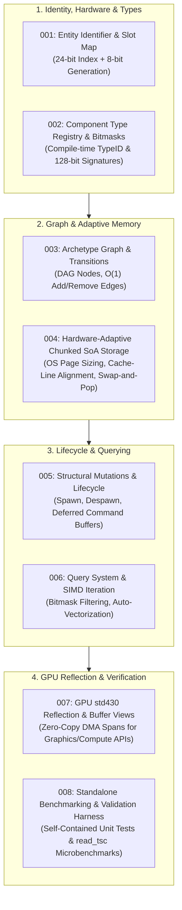

# Master Architectural Roadmap & Overview: `arche-ecs`

## 1. System Mission & Core Directives

`arche-ecs` is a purpose-built, high-throughput, cache-saturated C++20 Archetype Entity-Component-System (ECS) library developed as a **completely standalone, zero-dependency library**. 

It is designed to serve as a high-performance foundation for extreme-density numerical simulations (such as the Colony swarm simulation), while maintaining full independence so it can be built, tested, and benchmarked entirely on its own.

### Architectural Philosophy
1. **Zero Feature Bloat:** Unlike general-purpose engine ECS libraries (e.g., Flecs), `arche-ecs` omits runtime scripting, web dashboards, and deep hierarchical graph traversal. It focuses 100% on **pure sequential iteration speed, deterministic hardware cycle limits, and minimal cache line misses**.
2. **Hardware-Adaptive Scalability:** Cache line sizes and virtual memory page sizes vary across hardware architectures (e.g. 64 bytes and 4 KB on x86-64 vs. 128 bytes and 16 KB on Apple Silicon). The engine provides **Hardware Topology utilities** that detect and scale chunk page sizes and memory alignments dynamically to extract peak throughput on the host machine.
3. **Strict Library Independence:** `arche-ecs` is completely decoupled from any specific consumer project. It provides its own self-contained test suite, microbenchmarks, and CMake build configuration.
4. **Memory Alignment Priority:** Data is organized into hardware-page-aligned chunks, matching Vulkan/DirectX `std430` layout rules directly for zero-copy GPU DMA streaming.
5. **Target Hardware Budget:** Every component query and system update is engineered to execute within strict, deterministic CPU cycle budgets (`read_tsc()`).

---

## 2. The Complete Implementation Blueprint

The implementation plan is broken down into 8 modular architectural chapters:

---

## 3. Directory & File Manifest in `docs/4_arche_ecs_implementation/`

| Overview Document | Primary Module | Core Focus |
| :--- | :--- | :--- |
| **[`001_entity_identifier_and_slot_map.md`](file:///Users/student/Documents/colony/docs/4_arche_ecs_implementation/001_entity_identifier_and_slot_map.md)** | `arche::Entity`, `arche::SlotMap` | Generational 32-bit entity IDs, stale handle safety, $O(1)$ recycling free-list. |
| **[`002_component_type_registry_and_bitmasks.md`](file:///Users/student/Documents/colony/docs/4_arche_ecs_implementation/002_component_type_registry_and_bitmasks.md)** | `arche::TypeRegistry`, `arche::ComponentMask` | Compile-time static type indices, type descriptors (destructors, alignment, size), 128-bit bitmasks. |
| **[`003_archetype_graph_and_transitions.md`](file:///Users/student/Documents/colony/docs/4_arche_ecs_implementation/003_archetype_graph_and_transitions.md)** | `arche::Archetype`, `arche::ArchetypeGraph` | Directed Acyclic Graph topology, $O(1)$ cached transition edges (`Add<T>`, `Remove<T>`). |
| **[`004_chunked_soa_memory_storage.md`](file:///Users/student/Documents/colony/docs/4_arche_ecs_implementation/004_chunked_soa_memory_storage.md)** | `arche::Chunk`, `arche::Hardware` | **Hardware-adaptive** memory pages, dynamic cache-line alignment (64B / 128B), OS page scaling (4KB / 16KB), SoA slices, and Swap-and-Pop. |
| **[`005_structural_mutations_and_lifecycle.md`](file:///Users/student/Documents/colony/docs/4_arche_ecs_implementation/005_structural_mutations_and_lifecycle.md)** | `arche::World` lifecycle methods | Entity spawning, cross-archetype component byte copying, deferred mutation command buffers. |
| **[`006_query_system_and_simd_iteration.md`](file:///Users/student/Documents/colony/docs/4_arche_ecs_implementation/006_query_system_and_simd_iteration.md)** | `arche::Query<...>` | Bitmask filtering, raw pointer chunk iteration, auto-vectorization across AVX-512 and ARM Neon. |
| **[`007_vulkan_std430_reflection_and_streaming.md`](file:///Users/student/Documents/colony/docs/4_arche_ecs_implementation/007_vulkan_std430_reflection_and_streaming.md)** | `arche::GpuBridge` | Standardized `std430` memory layout reflection, providing generic continuous spans for GPU vertex and compute storage buffers. |
| **[`008_benchmarking_and_validation_harness.md`](file:///Users/student/Documents/colony/docs/4_arche_ecs_implementation/008_benchmarking_and_validation_harness.md)** | `arche_tests`, `arche_benchmarks` | **100% standalone** test suite and cycle-counting microbenchmarks without any external project dependencies. |

---

## 4. Next Step
Read through these overview files. Once you approve the overview structure, we will write the exhaustive, step-by-step implementation plan for each file one by one.
