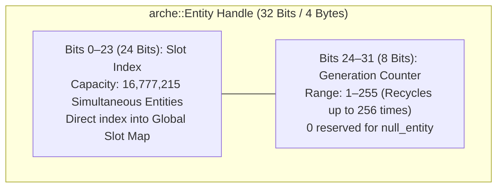
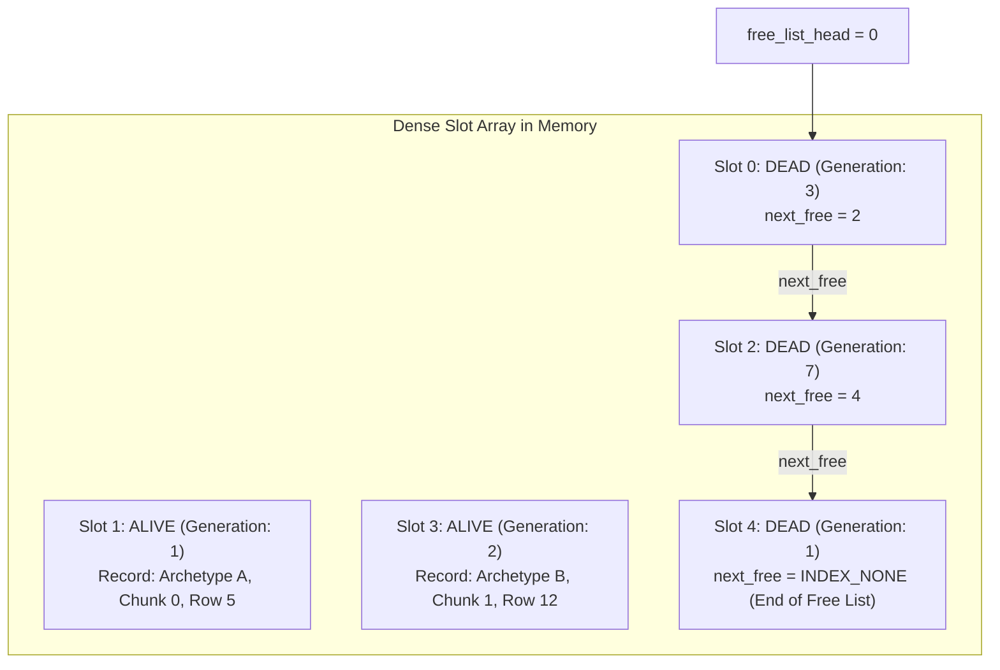
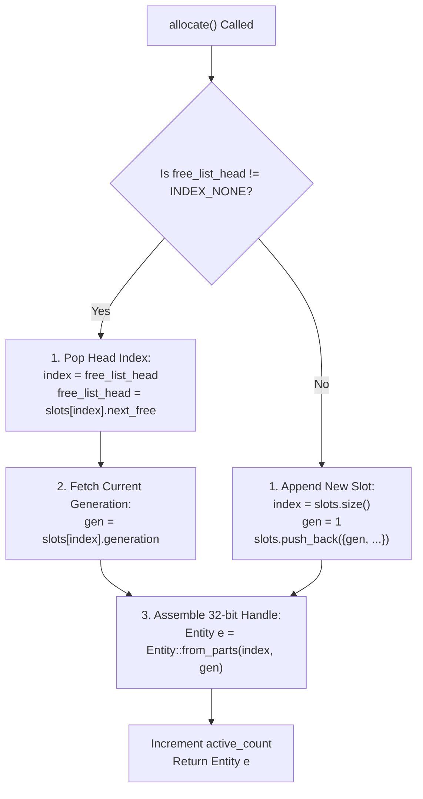
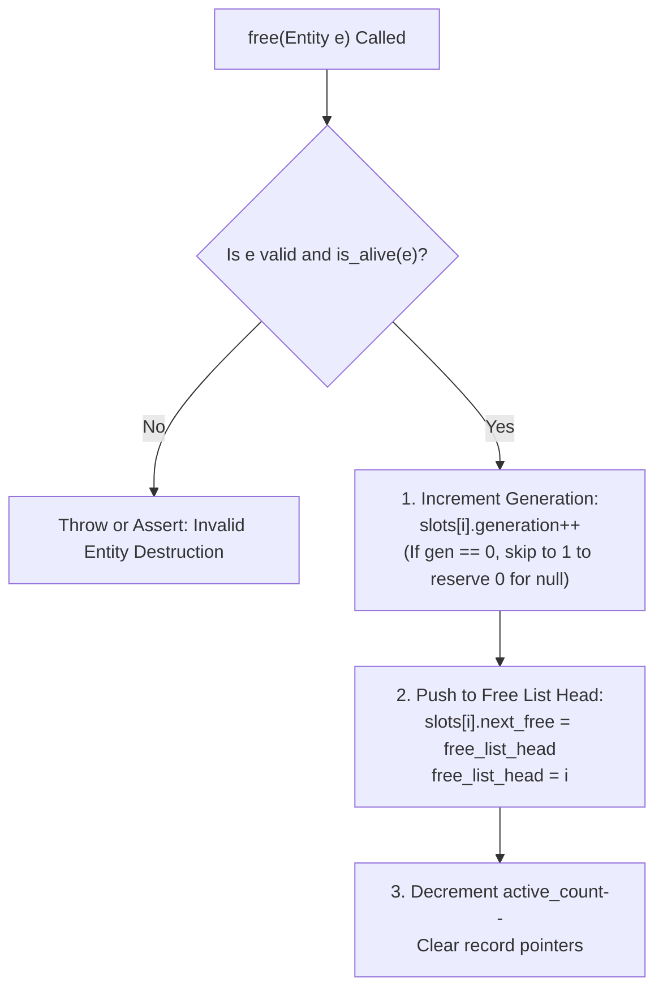
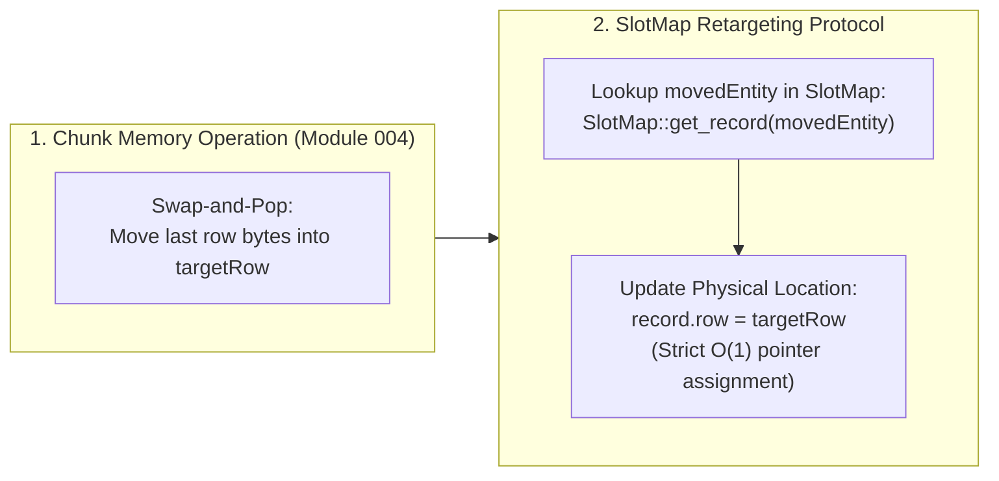

# Module 001: Entity Identifier & Generational Slot Map

This document establishes the exhaustive architectural specification, physical memory layouts, algorithms, and complete C++20 implementation for the **Entity Identifier & Generational Slot Map** subsystem of `arche-ecs`.

---

## 1. Architectural Mission & First Principles

In an archetype-based Entity-Component-System:
* An **Entity** is not a container, class, or pointer. It is an **opaque 32-bit generational integer key**.
* Entities undergo rapid structural mutation: adding components moves an entity to a different archetype chunk, deleting an entity causes a neighboring entity to move via **Swap-and-Pop**, and dead entities are continuously recycled.
* If a system retains an entity handle and attempts to access it after deletion, accessing that memory must **never** return corrupted data or cause undefined behavior.

The **Entity Identifier & Slot Map** subsystem solves these problems with three fundamental invariants:
1. **$O(1)$ Time Complexity:** Allocating an entity, freeing an entity, testing validity (`is_alive`), and updating an entity's physical row location all execute in strict $O(1)$ time.
2. **Generational Stale-Handle Protection:** Recycled slots increment their generation counter, causing obsolete entity handles to fail validity checks instantly in $1$ CPU clock cycle.
3. **Register-Sized Footprint (32 bits):** Entities fit into a single 32-bit CPU register (`uint32_t`), allowing them to be passed by value with zero stack spilling and packed densely in memory.

---

## 2. Binary Encoding: The 32-Bit Generational Handle

An `arche::Entity` is represented as a single 32-bit unsigned integer split into two bitfields:



### Mathematical Bit Allocation Trade-Off

| Field | Width | Mask | Range | Architectural Rationale |
| :--- | :---: | :---: | :---: | :--- |
| **Index** | 24 Bits | `0x00FFFFFF` | $0 \dots 16{,}777{,}215$ | Allows up to **16.7 million simultaneous active entities** in memory, far exceeding the 50,000+ swarm requirement. |
| **Generation** | 8 Bits | `0xFF000000` | $1 \dots 255$ | Supports up to 256 recycling lifecycles per slot before wrapping. Generation `0` is strictly reserved for `null_entity`. |

### The Dangling Handle Hazard (Use-After-Free Prevention)
Consider what happens without a generation counter:
```
1. Frame 10:  Entity A is spawned at Slot 42. (Handle = 42).
2. Frame 12:  System destroys Entity A. Slot 42 is returned to the free list.
3. Frame 13:  System spawns Entity B. Slot 42 is recycled and given to Entity B.
4. Frame 14:  An old AI task still holding Handle 42 modifies Position.
              ===> IT ACCIDENTALLY MUTATES ENTITY B! (Catastrophic logic bug!)
```

With an 8-bit generation counter:
```
1. Frame 10:  Entity A spawned at Slot 42, Generation 1. (Handle = (1 << 24) | 42).
2. Frame 12:  Entity A destroyed. Slot 42 generation increments to 2.
3. Frame 13:  Entity B spawned at Slot 42, Generation 2. (Handle = (2 << 24) | 42).
4. Frame 14:  Old AI task attempts to use Handle A:
              Compare Handle.Generation (1) == Slot.Generation (2) -> MISMATCH!
              ===> is_alive(Handle A) returns FALSE in 1 cycle. Access rejected!
```

---

## 3. Physical Location Record: `arche::EntityRecord`

Because entities move dynamically across chunks and archetypes, the Slot Map stores a physical location record for every live entity:

```cpp
namespace arche::Internal {

struct Chunk;     // Forward declaration (Module 004)
struct Archetype; // Forward declaration (Module 003)

struct EntityRecord {
    Archetype* archetype{nullptr}; // Pointer to current archetype node
    Chunk*     chunk{nullptr};     // Pointer to current 64 KB memory page
    uint32_t   row{0};             // Row index within chunk SoA slices
};

} // namespace arche::Internal
```

### Memory Footprint & Cache Efficiency
* On 64-bit systems, an `EntityRecord` takes 24 bytes ($8\text{ B} + 8\text{ B} + 4\text{ B} + 4\text{ B padding}$).
* A slot map storing 50,000 active entities consumes only $\approx 1.2\text{ MB}$ of system RAM, fitting comfortably within the CPU's L3 cache.

---

## 4. The Intrusive Free-List Slot Map Architecture

The `SlotMap` consists of a single contiguous `std::vector<Slot>` paired with an intrusive singly-linked free list:



### Dual-State Slot Union
To avoid wasting memory, each slot uses a union: when alive, it holds the entity's physical record; when dead, it holds the index of the next available free slot:

```cpp
struct Slot {
    uint8_t generation{1}; // Generation counter
    union {
        EntityRecord record;    // Valid when ALIVE
        uint32_t     next_free; // Valid when DEAD (intrusive free-list pointer)
    };
};
```

---

## 5. Core Algorithmic Workflows

### 5.1 Entity Allocation (`allocate()`) — Strict $O(1)$


```cpp
Entity SlotMap::allocate() {
    uint32_t index = 0;
    uint8_t generation = 1;

    if (free_list_head != INDEX_NONE) {
        index = free_list_head;
        free_list_head = slots[index].next_free;
        generation = slots[index].generation;
    } else {
        if (slots.size() >= MAX_ENTITIES) {
            throw std::runtime_error("arche::SlotMap capacity exceeded (16.7M entities limit)");
        }
        index = static_cast<uint32_t>(slots.size());
        slots.emplace_back();
        slots[index].generation = 1;
        generation = 1;
    }

    slots[index].record = EntityRecord{}; // Initialize clear record
    ++active_count;
    return Entity::from_parts(index, generation);
}
```

---

### 5.2 Entity Destruction (`free(Entity e)`) — Strict $O(1)$


```cpp
void SlotMap::free(Entity e) noexcept {
    const uint32_t index = e.index();
    
    // Invalidate stale handles by advancing generation counter
    uint8_t next_gen = slots[index].generation + 1;
    if (next_gen == 0) {
        next_gen = 1; // Preserve generation 0 strictly for null_entity
    }
    slots[index].generation = next_gen;

    // Intrusively push slot index to front of free-list
    slots[index].next_free = free_list_head;
    free_list_head = index;

    --active_count;
}
```

---

### 5.3 Swap-and-Pop Location Synchronization Protocol
When an entity at `targetRow` is deleted from a chunk, the chunk moves the **last active entity** (`movedEntity`) into `targetRow` to keep memory 100% contiguous:



```cpp
void SlotMap::update_row(Entity e, uint32_t newRow) noexcept {
    slots[e.index()].record.row = newRow;
}
```

---

## 6. Complete C++20 Header Implementation: `arche/entity.hpp`

```cpp
#pragma once

#include <compare>
#include <cstdint>
#include <functional>

namespace arche {

// Forward declarations
namespace Internal {
struct Chunk;
struct Archetype;
}

/**
 * @class Entity
 * @brief Opaque, 32-bit generational handle identifying an entity in arche-ecs.
 *
 * Bitfield Encoding:
 * - Bits 0–23 (24 bits): Dense slot index (up to 16,777,215 entities).
 * - Bits 24–31 (8 bits): Generation counter (detects stale recycled handles).
 */
class Entity {
public:
    static constexpr uint32_t INDEX_BITS       = 24;
    static constexpr uint32_t GENERATION_BITS  = 8;
    static constexpr uint32_t INDEX_MASK       = 0x00FFFFFF;
    static constexpr uint32_t GENERATION_MASK  = 0xFF000000;
    static constexpr uint32_t INDEX_NONE       = 0x00FFFFFF;

    constexpr Entity() noexcept : value(0) {}

    [[nodiscard]] static constexpr Entity from_parts(uint32_t index, uint8_t generation) noexcept {
        Entity e;
        e.value = (static_cast<uint32_t>(generation) << INDEX_BITS) | (index & INDEX_MASK);
        return e;
    }

    [[nodiscard]] static constexpr Entity from_raw(uint32_t rawValue) noexcept {
        Entity e;
        e.value = rawValue;
        return e;
    }

    [[nodiscard]] constexpr uint32_t id() const noexcept {
        return value & INDEX_MASK;
    }

    [[nodiscard]] constexpr uint32_t index() const noexcept {
        return value & INDEX_MASK;
    }

    [[nodiscard]] constexpr uint8_t generation() const noexcept {
        return static_cast<uint8_t>((value >> INDEX_BITS) & 0xFF);
    }

    [[nodiscard]] constexpr uint32_t raw() const noexcept {
        return value;
    }

    [[nodiscard]] constexpr explicit operator bool() const noexcept {
        return value != 0;
    }

    // C++20 Three-Way Comparison (Spaceship Operator)
    constexpr auto operator<=>(const Entity& other) const noexcept = default;
    constexpr bool operator==(const Entity& other) const noexcept = default;

private:
    uint32_t value{0};
};

/**
 * @brief Canonical sentinel representing an invalid or non-existent entity.
 */
inline constexpr Entity null_entity = Entity::from_parts(0, 0);

} // namespace arche

// Standard Hash Specialization for std::unordered_map / std::unordered_set
template <>
struct std::hash<arche::Entity> {
    [[nodiscard]] std::size_t operator()(const arche::Entity& e) const noexcept {
        return std::hash<uint32_t>{}(e.raw());
    }
};
```

---

## 7. Complete C++20 Implementation: `arche/slot_map.hpp`

```cpp
#pragma once

#include "arche/entity.hpp"

#include <cstdint>
#include <stdexcept>
#include <vector>

namespace arche::Internal {

struct EntityRecord {
    Archetype* archetype{nullptr};
    Chunk*     chunk{nullptr};
    uint32_t   row{0};
};

class SlotMap {
public:
    static constexpr uint32_t INDEX_NONE   = Entity::INDEX_NONE;
    static constexpr uint32_t MAX_ENTITIES = Entity::INDEX_MASK;

    SlotMap() = default;

    [[nodiscard]] Entity allocate() {
        uint32_t index = 0;
        uint8_t generation = 1;

        if (free_list_head != INDEX_NONE) {
            index = free_list_head;
            free_list_head = slots[index].next_free;
            generation = slots[index].generation;
        } else {
            if (slots.size() >= MAX_ENTITIES) {
                throw std::runtime_error("arche::SlotMap: capacity limit reached (16.7M entities)");
            }
            index = static_cast<uint32_t>(slots.size());
            slots.emplace_back();
            slots[index].generation = 1;
            generation = 1;
        }

        slots[index].record = EntityRecord{};
        ++active_count;
        return Entity::from_parts(index, generation);
    }

    void free(Entity e) noexcept {
        const uint32_t index = e.index();
        
        uint8_t next_gen = slots[index].generation + 1;
        if (next_gen == 0) {
            next_gen = 1; // Preserve generation 0 for null_entity
        }
        slots[index].generation = next_gen;

        // Link into intrusive free list
        slots[index].next_free = free_list_head;
        free_list_head = index;

        --active_count;
    }

    [[nodiscard]] bool is_alive(Entity e) const noexcept {
        const uint32_t index = e.index();
        if (index >= slots.size() || e == null_entity) {
            return false;
        }
        return slots[index].generation == e.generation();
    }

    [[nodiscard]] EntityRecord& get_record(Entity e) {
        return slots[e.index()].record;
    }

    [[nodiscard]] const EntityRecord& get_record(Entity e) const {
        return slots[e.index()].record;
    }

    void update_location(Entity e, Archetype* arch, Chunk* chunk, uint32_t row) noexcept {
        slots[e.index()].record = EntityRecord{arch, chunk, row};
    }

    void update_row(Entity e, uint32_t newRow) noexcept {
        slots[e.index()].record.row = newRow;
    }

    [[nodiscard]] size_t size() const noexcept {
        return active_count;
    }

    [[nodiscard]] size_t capacity() const noexcept {
        return slots.size();
    }

    void clear() noexcept {
        slots.clear();
        free_list_head = INDEX_NONE;
        active_count = 0;
    }

private:
    struct Slot {
        uint8_t generation{1};
        union {
            EntityRecord record;
            uint32_t     next_free{INDEX_NONE};
        };

        Slot() : generation(1), next_free(INDEX_NONE) {}
        ~Slot() {} // Trivial cleanup
    };

    std::vector<Slot> slots;
    uint32_t          free_list_head{INDEX_NONE};
    size_t            active_count{0};
};

} // namespace arche::Internal
```

---

## 8. Standalone Unit Test Suite Specification (`tests/entity_tests.cpp`)

This test suite is **100% self-contained** within the `arche-ecs` repository and does not link or depend on any external project:

### Test Case 1: Handle Bitfield Integrity & Null Entity
```cpp
void test_entity_bitfield() {
    Entity e = Entity::from_parts(42, 7);
    assert(e.index() == 42);
    assert(e.id() == 42);
    assert(e.generation() == 7);
    assert(static_cast<bool>(e) == true);

    assert(null_entity.raw() == 0);
    assert(null_entity.index() == 0);
    assert(null_entity.generation() == 0);
    assert(static_cast<bool>(null_entity) == false);
}
```

### Test Case 2: $O(1)$ LIFO Free-List Recycling & Generational Increment
```cpp
void test_slotmap_lifecycle_and_stale_handles() {
    Internal::SlotMap map;
    assert(map.size() == 0);

    // 1. Allocate initial entities
    Entity e1 = map.allocate();
    Entity e2 = map.allocate();
    assert(e1.index() == 0 && e1.generation() == 1);
    assert(e2.index() == 1 && e2.generation() == 1);
    assert(map.is_alive(e1));
    assert(map.is_alive(e2));

    // 2. Free e1
    map.free(e1);
    assert(!map.is_alive(e1)); // Stale handle detection
    assert(map.is_alive(e2));

    // 3. Re-allocate: slot 0 must be recycled with incremented generation
    Entity e1_recycled = map.allocate();
    assert(e1_recycled.index() == 0);
    assert(e1_recycled.generation() == 2); // Generation advanced
    assert(map.is_alive(e1_recycled));
    assert(!map.is_alive(e1));             // Original handle e1 remains permanently dead!
}
```

### Test Case 3: High-Volume Stress Test (1,000,000 Iterations)
```cpp
void test_million_entity_stress() {
    Internal::SlotMap map;
    std::vector<Entity> active;
    active.reserve(100'000);

    // Spawn 100,000 entities
    for (int i = 0; i < 100'000; ++i) {
        active.push_back(map.allocate());
    }
    assert(map.size() == 100'000);

    // Despawn every second entity (50,000 entities freed)
    for (int i = 0; i < 100'000; i += 2) {
        map.free(active[i]);
    }
    assert(map.size() == 50'000);

    // Verify survivors are alive and deleted are dead
    for (int i = 0; i < 100'000; ++i) {
        if (i % 2 == 0) {
            assert(!map.is_alive(active[i]));
        } else {
            assert(map.is_alive(active[i]));
        }
    }

    // Respawn 50,000 entities into recycled slots
    for (int i = 0; i < 50'000; ++i) {
        Entity recycled = map.allocate();
        assert(recycled.generation() >= 2);
    }
    assert(map.size() == 100'000);
}
```

### Test Case 4: Generation Wrap-Around Safety ($255 \to 1$)
```cpp
void test_generation_wrap_around() {
    Internal::SlotMap map;
    Entity e = map.allocate();
    assert(e.generation() == 1);

    // Recycle slot 255 times
    for (int i = 0; i < 254; ++i) {
        map.free(e);
        e = map.allocate();
    }
    assert(e.generation() == 255);

    // Trigger wrap-around: must advance to 1, skipping 0 (null_entity)
    map.free(e);
    Entity wrapped = map.allocate();
    assert(wrapped.generation() == 1);
    assert(wrapped != null_entity);
}
```

---

## 9. Performance & Complexity Guarantees

| Operation | Time Complexity | CPU Instructions | Cache-Line Cost |
| :--- | :---: | :---: | :---: |
| `allocate()` (recycle) | $\mathbf{O(1)}$ | $\approx 4\text{ instructions}$ | 1 L1 cache access |
| `allocate()` (grow) | $\mathbf{O(1)}$ amortized | Vector resize | Amortized zero |
| `free()` | $\mathbf{O(1)}$ | $\approx 5\text{ instructions}$ | 1 L1 cache access |
| `is_alive()` | $\mathbf{O(1)}$ | $\approx 2\text{ instructions}$ (1 compare, 1 branch) | 1 L1 cache access |
| `update_row()` | $\mathbf{O(1)}$ | $\approx 1\text{ store instruction}$ | 1 L1 cache access |
