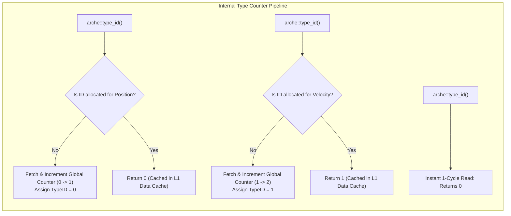
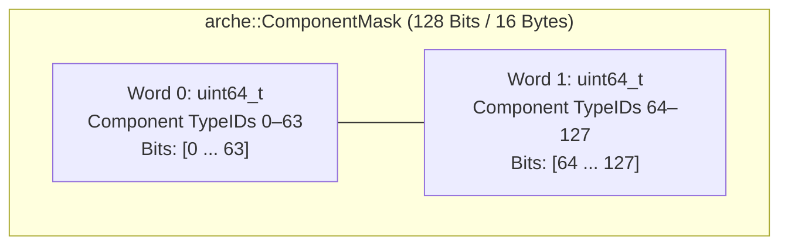
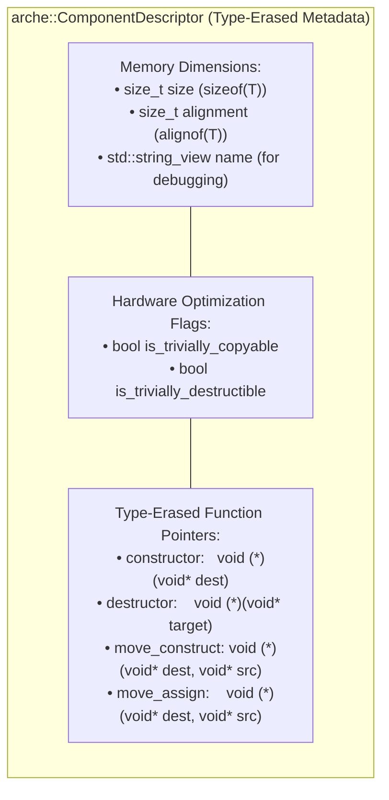

# Module 002: Component Type Registry & Bitmasks

This document establishes the exhaustive architectural specification, physical memory layouts, algorithms, and complete C++20 implementation for the **Component Type Registry & 128-Bit Component Mask** subsystem of `arche-ecs`.

---

## 1. Architectural Mission & First Principles

In an archetype-based Entity-Component-System:
* Components are user-defined C++ Plain-Old-Data (POD) types (e.g. `struct Position { float x, y; };`).
* The engine must inspect, compare, group, and match sets of components across millions of iterations per second.
* Relying on standard C++ RTTI (`typeid` or `std::type_index`) is strictly unacceptable: it introduces dynamic runtime hashing, non-contiguous integer IDs, string comparisons, and non-deterministic behavior across shared library boundaries.

The **Component Type Registry & Bitmask** subsystem solves these problems with three fundamental invariants:
1. **Dense Sequential Type IDs:** Assigns every component a unique, contiguous 0-indexed integer (`TypeID = 0, 1, 2, ... N-1`). This allows component metadata to be indexed directly into flat C-arrays without hash tables or pointer chasing.
2. **128-Bit Signature Bitmasks:** Represents archetype component signatures as a compact 128-bit bitmask (`ComponentMask`), enabling query inclusion/exclusion matching to execute in **1 to 2 CPU clock cycles**.
3. **Type-Erased Memory Descriptors:** Provides metadata function pointers (construction, destruction, move assignment) and triviality flags so chunk storage can allocate, relocate, and free component memory safely without knowing their concrete types at compile time.

---

## 2. Compile-Time Monotonic Type ID Generation

To produce dense, 0-indexed integers without global mutexes or dynamic string maps, `arche-ecs` uses a template-specialized inline static counter:



### The Static Counter Idiom
```cpp
namespace arche::Internal {

inline uint32_t allocate_next_type_id() noexcept {
    static uint32_t counter = 0;
    return counter++;
}

template <typename T>
inline uint32_t get_static_type_id() noexcept {
    static const uint32_t id = allocate_next_type_id();
    return id;
}

} // namespace arche::Internal

template <typename T>
[[nodiscard]] inline uint32_t type_id() noexcept {
    return Internal::get_static_type_id<std::decay_t<T>>();
}
```

* **Zero Runtime Overhead:** On subsequent calls, `type_id<T>()` compiles down to reading a single statically allocated integer in memory—executing in a single CPU cycle.
* **Dense Monotonic Sequence:** The first registered component is `0`, the second is `1`, the third is `2`, and so forth.

---

## 3. The 128-Bit Component Mask (`arche::ComponentMask`)

An archetype's signature—the set of all components an entity possesses—is represented as an unrolled **128-bit bitfield**:



### Why 128 Bits is the Optimal Architecture Budget
1. **Capacity:** A game or physics simulation rarely defines more than 50 to 80 component types. 128 bits provides extensive headroom.
2. **Register Allocation:** 128 bits fits into two 64-bit general-purpose CPU registers (`uint64_t words[2]`), or a single 128-bit SIMD register (x86 SSE/AVX or ARM Neon).
3. **Hardware Acceleration:** Hardware CPU bitwise instructions (`AND`, `OR`, `POPCNT`) evaluate inclusion and exclusion filters instantaneously.

### Mathematical Operations & Hardware Intrinsics

$$\text{Bit Position Calculation:}\quad \text{word\_index} = \frac{\text{TypeID}}{64}, \quad \text{bit\_offset} = \text{TypeID} \pmod{64}$$

| Bitmask Operation | Mathematical Definition | Hardware Assembly Implementation |
| :--- | :--- | :--- |
| **`set(TypeID id)`** | $\text{Mask} \leftarrow \text{Mask} \mid (1 \ll \text{id})$ | `bts` (Bit Test and Set) / `OR` |
| **`reset(TypeID id)`** | $\text{Mask} \leftarrow \text{Mask} \ \& \ \sim(1 \ll \text{id})$ | `btr` (Bit Test and Reset) / `AND NOT` |
| **`test(TypeID id)`** | $(\text{Mask} \ \& \ (1 \ll \text{id})) \ne 0$ | `bt` (Bit Test) |
| **`contains_all(Query)`** | $(\text{Mask} \ \& \ \text{Query}) == \text{Query}$ | 2 `AND` instructions + 2 comparisons |
| **`contains_none(Query)`** | $(\text{Mask} \ \& \ \text{Query}) == 0$ | 2 `AND` instructions + 2 zero-checks |
| **`count()`** | $\sum \text{bits}$ | `__builtin_popcountll(w0) + __builtin_popcountll(w1)` |

---

## 4. Component Type Descriptors (`arche::ComponentDescriptor`)

Raw memory chunks (Module 004) store untyped bytes. When an entity is moved between chunks or destroyed, the engine must safely invoke constructors, destructors, or memory copies without knowing the component's concrete compile-time type:



### The Fast-Path Optimization: Trivial POD Types
When components are trivial Plain-Old-Data (such as `struct Position { float x, y; };`):
* `is_trivially_copyable == true`: The engine skips function pointer calls completely and uses **`std::memcpy` in bulk**, saturating CPU bus bandwidth.
* `is_trivially_destructible == true`: The engine skips the destruction loop entirely when freeing chunks or deleting entities, saving thousands of clock cycles.

---

## 5. Canonical Signature Sorting

In `arche-ecs`, component sets that define an archetype are **always sorted in strictly ascending TypeID order**:

$$\text{Archetype Signature} = [T_0, T_1, T_2, \dots, T_{k-1}], \quad \text{where } T_0 < T_1 < T_2 < \dots < T_{k-1}$$

### Why Canonical Sorting is Mandatory
If entity 1 is created with `[Position, Velocity]` (TypeIDs 0 and 1) and entity 2 is created with `[Velocity, Position]` (TypeIDs 1 and 0):
* Unsorted sets would evaluate as distinct archetypes, allocating two duplicate chunk memory pools and fragmenting CPU cache lines.
* By enforcing canonical ascending order, both combinations resolve to the exact same canonical array `[0, 1]`, guaranteeing **zero archetype duplication**.

---

## 6. Complete C++20 Implementation: `arche/type_id.hpp`

```cpp
#pragma once

#include <cstdint>
#include <string_view>
#include <type_traits>

namespace arche {

using TypeID = uint32_t;
inline constexpr TypeID INVALID_TYPE_ID = 0xFFFFFFFF;

namespace Internal {

inline TypeID allocate_type_id_sequential() noexcept {
    static TypeID global_counter = 0;
    return global_counter++;
}

template <typename T>
inline TypeID get_or_allocate_type_id() noexcept {
    static const TypeID id = allocate_type_id_sequential();
    return id;
}

// Compile-time demangled type name helper (for debugging and logging)
template <typename T>
constexpr std::string_view get_type_name() noexcept {
#if defined(__clang__) || defined(__GNUC__)
    constexpr std::string_view prefix = "[with T = ";
    constexpr std::string_view suffix = "]";
    constexpr std::string_view sig = __PRETTY_FUNCTION__;
    const size_t start = sig.find(prefix);
    if (start == std::string_view::npos) return "Unknown";
    const size_t end = sig.find(suffix, start);
    return sig.substr(start + prefix.size(), end - (start + prefix.size()));
#elif defined(_MSC_VER)
    constexpr std::string_view prefix = "get_type_name<";
    constexpr std::string_view suffix = ">(";
    constexpr std::string_view sig = __FUNCSIG__;
    const size_t start = sig.find(prefix);
    if (start == std::string_view::npos) return "Unknown";
    const size_t end = sig.find(suffix, start);
    return sig.substr(start + prefix.size(), end - (start + prefix.size()));
#else
    return "Unknown";
#endif
}

} // namespace Internal

/**
 * @brief Retrieves the unique, sequential 0-indexed TypeID for a component type.
 *
 * @tparam T Component struct or class.
 * @return TypeID Unique sequential integer (0, 1, 2, ...).
 */
template <typename T>
[[nodiscard]] inline TypeID type_id() noexcept {
    return Internal::get_or_allocate_type_id<std::decay_t<T>>();
}

/**
 * @brief Retrieves the human-readable string name of a component type.
 */
template <typename T>
[[nodiscard]] constexpr std::string_view type_name() noexcept {
    return Internal::get_type_name<std::decay_t<T>>();
}

} // namespace arche
```

---

## 7. Complete C++20 Implementation: `arche/component_mask.hpp`

```cpp
#pragma once

#include "arche/type_id.hpp"

#include <bit>
#include <compare>
#include <cstdint>
#include <stdexcept>

namespace arche {

/**
 * @class ComponentMask
 * @brief 128-bit fixed-width component signature bitmask.
 *
 * Supports up to 128 distinct component types with 1-to-2 cycle bitwise matching.
 */
class ComponentMask {
public:
    static constexpr size_t MAX_COMPONENTS = 128;
    static constexpr size_t WORDS_COUNT    = 2;

    constexpr ComponentMask() noexcept : words{0, 0} {}

    constexpr void set(TypeID id) noexcept {
        if (id < 64) {
            words[0] |= (1ULL << id);
        } else if (id < 128) {
            words[1] |= (1ULL << (id - 64));
        }
    }

    constexpr void reset(TypeID id) noexcept {
        if (id < 64) {
            words[0] &= ~(1ULL << id);
        } else if (id < 128) {
            words[1] &= ~(1ULL << (id - 64));
        }
    }

    [[nodiscard]] constexpr bool test(TypeID id) const noexcept {
        if (id < 64) {
            return (words[0] & (1ULL << id)) != 0;
        } else if (id < 128) {
            return (words[1] & (1ULL << (id - 64))) != 0;
        }
        return false;
    }

    [[nodiscard]] constexpr bool contains_all(const ComponentMask& query) const noexcept {
        return ((words[0] & query.words[0]) == query.words[0]) &&
               ((words[1] & query.words[1]) == query.words[1]);
    }

    [[nodiscard]] constexpr bool contains_none(const ComponentMask& excluded) const noexcept {
        return ((words[0] & excluded.words[0]) == 0) &&
               ((words[1] & excluded.words[1]) == 0);
    }

    [[nodiscard]] constexpr bool contains_any(const ComponentMask& filter) const noexcept {
        return ((words[0] & filter.words[0]) != 0) ||
               ((words[1] & filter.words[1]) != 0);
    }

    [[nodiscard]] constexpr size_t count() const noexcept {
        return static_cast<size_t>(std::popcount(words[0]) + std::popcount(words[1]));
    }

    [[nodiscard]] constexpr bool empty() const noexcept {
        return words[0] == 0 && words[1] == 0;
    }

    constexpr void clear() noexcept {
        words[0] = 0;
        words[1] = 0;
    }

    // Bitwise Operator Overloads
    constexpr ComponentMask operator&(const ComponentMask& other) const noexcept {
        ComponentMask result;
        result.words[0] = words[0] & other.words[0];
        result.words[1] = words[1] & other.words[1];
        return result;
    }

    constexpr ComponentMask operator|(const ComponentMask& other) const noexcept {
        ComponentMask result;
        result.words[0] = words[0] | other.words[0];
        result.words[1] = words[1] | other.words[1];
        return result;
    }

    constexpr ComponentMask operator^(const ComponentMask& other) const noexcept {
        ComponentMask result;
        result.words[0] = words[0] ^ other.words[0];
        result.words[1] = words[1] ^ other.words[1];
        return result;
    }

    constexpr ComponentMask operator~() const noexcept {
        ComponentMask result;
        result.words[0] = ~words[0];
        result.words[1] = ~words[1];
        return result;
    }

    // Three-Way Comparison Synthesis
    constexpr auto operator<=>(const ComponentMask& other) const noexcept = default;
    constexpr bool operator==(const ComponentMask& other) const noexcept = default;

private:
    uint64_t words[WORDS_COUNT];
};

} // namespace arche
```

---

## 8. Complete C++20 Implementation: `arche/type_registry.hpp`

```cpp
#pragma once

#include "arche/component_mask.hpp"
#include "arche/type_id.hpp"

#include <cstring>
#include <memory>
#include <string_view>
#include <vector>

namespace arche {

/**
 * @struct ComponentDescriptor
 * @brief Type-erased memory dimensions and lifecycle function pointers for a component.
 */
struct ComponentDescriptor {
    TypeID           id{INVALID_TYPE_ID};
    size_t           size{0};
    size_t           alignment{0};
    std::string_view name{"Unknown"};
    bool             is_trivially_copyable{false};
    bool             is_trivially_destructible{false};

    void (*constructor)(void* target){nullptr};
    void (*destructor)(void* target){nullptr};
    void (*move_construct)(void* dest, void* src){nullptr};
    void (*move_assign)(void* dest, void* src){nullptr};

    template <typename T>
    [[nodiscard]] static ComponentDescriptor create() noexcept {
        using ComponentType = std::decay_t<T>;

        ComponentDescriptor desc;
        desc.id = type_id<ComponentType>();
        desc.size = sizeof(ComponentType);
        desc.alignment = alignof(ComponentType);
        desc.name = type_name<ComponentType>();
        desc.is_trivially_copyable = std::is_trivially_copyable_v<ComponentType>;
        desc.is_trivially_destructible = std::is_trivially_destructible_v<ComponentType>;

        // Constructor
        desc.constructor = [](void* target) {
            new (target) ComponentType();
        };

        // Destructor
        if constexpr (!std::is_trivially_destructible_v<ComponentType>) {
            desc.destructor = [](void* target) {
                static_cast<ComponentType*>(target)->~ComponentType();
            };
        }

        // Move Constructor
        desc.move_construct = [](void* dest, void* src) {
            new (dest) ComponentType(std::move(*static_cast<ComponentType*>(src)));
        };

        // Move Assignment
        desc.move_assign = [](void* dest, void* src) {
            *static_cast<ComponentType*>(dest) = std::move(*static_cast<ComponentType*>(src));
        };

        return desc;
    }
};

/**
 * @class TypeRegistry
 * @brief Centralized registry managing component descriptors and metadata.
 */
class TypeRegistry {
public:
    TypeRegistry() = default;

    template <typename T>
    const ComponentDescriptor& register_type() {
        const TypeID id = type_id<T>();
        if (id >= descriptors.size()) {
            descriptors.resize(id + 1);
        }
        if (descriptors[id].id == INVALID_TYPE_ID) {
            descriptors[id] = ComponentDescriptor::create<T>();
        }
        return descriptors[id];
    }

    template <typename T>
    [[nodiscard]] const ComponentDescriptor& get_descriptor() const {
        const TypeID id = type_id<T>();
        if (id >= descriptors.size() || descriptors[id].id == INVALID_TYPE_ID) {
            throw std::runtime_error("arche::TypeRegistry: Unregistered component type requested");
        }
        return descriptors[id];
    }

    [[nodiscard]] const ComponentDescriptor& get_descriptor(TypeID id) const {
        if (id >= descriptors.size() || descriptors[id].id == INVALID_TYPE_ID) {
            throw std::runtime_error("arche::TypeRegistry: Invalid TypeID requested");
        }
        return descriptors[id];
    }

    [[nodiscard]] size_t registered_count() const noexcept {
        return descriptors.size();
    }

private:
    std::vector<ComponentDescriptor> descriptors;
};

} // namespace arche
```

---

## 9. Standalone Unit Test Suite Specification (`tests/type_tests.cpp`)

This test suite is **100% self-contained** within the `arche-ecs` repository:

### Test Case 1: Sequential Contiguous TypeID Generation
```cpp
struct Pos { float x, y; };
struct Vel { float vx, vy; };
struct Mass { float m; };

void test_sequential_type_ids() {
    const TypeID id_pos  = type_id<Pos>();
    const TypeID id_vel  = type_id<Vel>();
    const TypeID id_mass = type_id<Mass>();

    assert(id_pos == 0);
    assert(id_vel == 1);
    assert(id_mass == 2);

    // Repeated lookups must return identical cached IDs
    assert(type_id<Pos>() == 0);
    assert(type_id<Vel>() == 1);
    assert(type_id<Mass>() == 2);
}
```

### Test Case 2: ComponentMask Bitwise Set, Test, and Population Count
```cpp
void test_component_mask_operations() {
    ComponentMask mask;
    assert(mask.empty());
    assert(mask.count() == 0);

    mask.set(0); // Pos
    mask.set(2); // Mass
    assert(mask.test(0) == true);
    assert(mask.test(1) == false);
    assert(mask.test(2) == true);
    assert(mask.count() == 2);

    mask.reset(0);
    assert(mask.test(0) == false);
    assert(mask.count() == 1);
}
```

### Test Case 3: Fast Query Matching (`contains_all` and `contains_none`)
```cpp
void test_query_filter_matching() {
    ComponentMask entity_mask;
    entity_mask.set(0); // Pos
    entity_mask.set(1); // Vel
    entity_mask.set(5); // ActiveTag

    ComponentMask query_include;
    query_include.set(0); // Wants Pos
    query_include.set(1); // Wants Vel

    ComponentMask query_exclude;
    query_exclude.set(10); // DeadTag

    // Must match: possesses both Pos and Vel, lacks DeadTag
    assert(entity_mask.contains_all(query_include) == true);
    assert(entity_mask.contains_none(query_exclude) == true);

    // Add DeadTag to entity: exclude filter must now reject it
    entity_mask.set(10);
    assert(entity_mask.contains_none(query_exclude) == false);
}
```

### Test Case 4: Descriptor Move & Destruction Semantics
```cpp
struct TrackedObject {
    int value{0};
    inline static int live_instances = 0;

    TrackedObject(int val = 0) : value(val) { ++live_instances; }
    ~TrackedObject() { --live_instances; }
    TrackedObject(const TrackedObject&) = delete;
    TrackedObject(TrackedObject&& other) noexcept : value(other.value) { ++live_instances; }
    TrackedObject& operator=(TrackedObject&& other) noexcept {
        value = other.value;
        return *this;
    }
};

void test_descriptor_lifecycle() {
    TypeRegistry registry;
    const auto& desc = registry.register_type<TrackedObject>();

    assert(!desc.is_trivially_destructible);
    assert(TrackedObject::live_instances == 0);

    // Allocate raw memory buffer
    alignas(TrackedObject) char bufferA[sizeof(TrackedObject)];
    alignas(TrackedObject) char bufferB[sizeof(TrackedObject)];

    // 1. Construct in Buffer A
    desc.constructor(bufferA);
    assert(TrackedObject::live_instances == 1);

    // 2. Move construct into Buffer B
    desc.move_construct(bufferB, bufferA);
    assert(TrackedObject::live_instances == 2);

    // 3. Destroy both buffers
    desc.destructor(bufferA);
    desc.destructor(bufferB);
    assert(TrackedObject::live_instances == 0);
}
```

---

## 10. Performance & Complexity Guarantees

| Operation | Time Complexity | CPU Instructions | Hardware Mechanism |
| :--- | :---: | :---: | :--- |
| `type_id<T>()` (subsequent call) | $\mathbf{O(1)}$ | $1\text{ instruction}$ | Direct static integer memory read |
| `mask.set()`, `mask.reset()` | $\mathbf{O(1)}$ | $1\text{--}2\text{ instructions}$ | Hardware `bts` / `btr` bitwise ALU |
| `mask.contains_all()` | $\mathbf{O(1)}$ | $2\text{ instructions}$ | Parallel 64-bit integer `AND` + compare |
| `mask.count()` | $\mathbf{O(1)}$ | $2\text{ instructions}$ | Hardware on-chip `popcnt` instruction |
| `registry.get_descriptor()` | $\mathbf{O(1)}$ | $1\text{ instruction}$ | Direct C-array indexing via TypeID |
