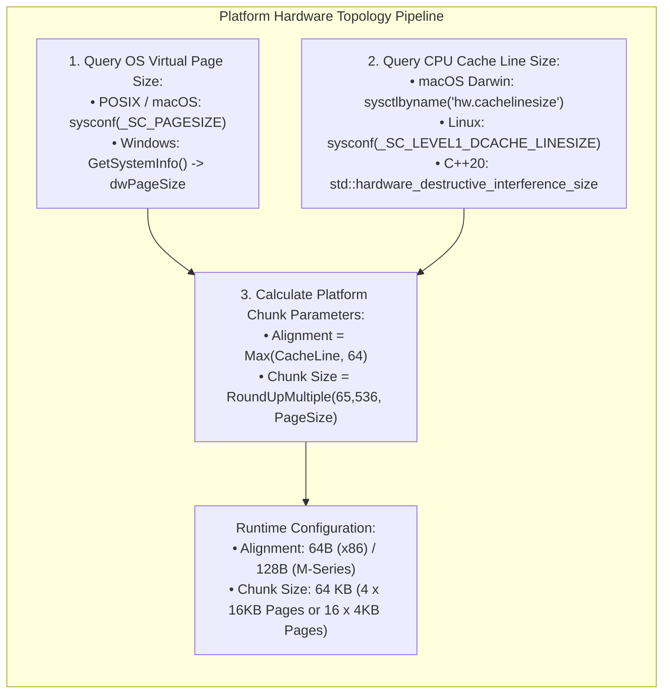
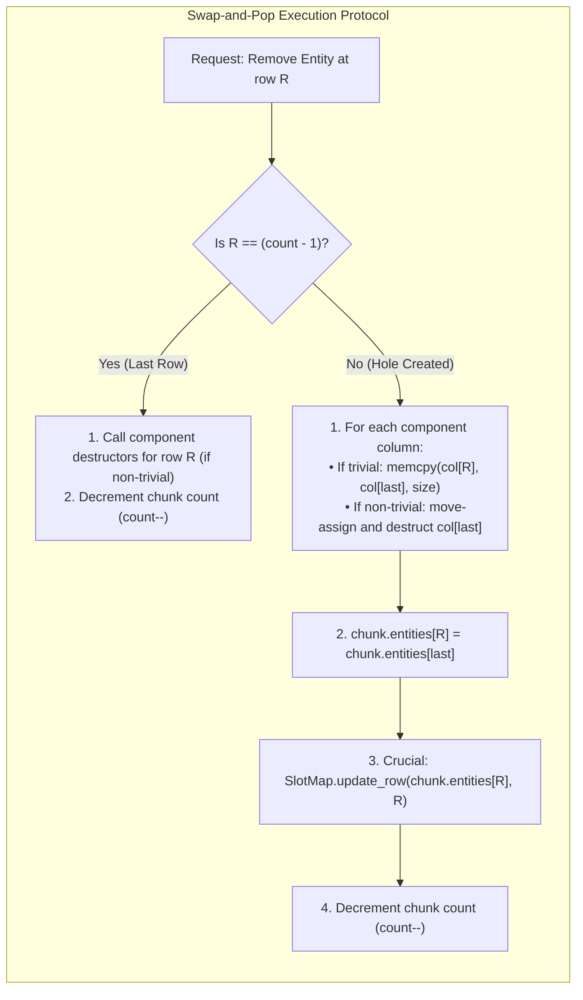
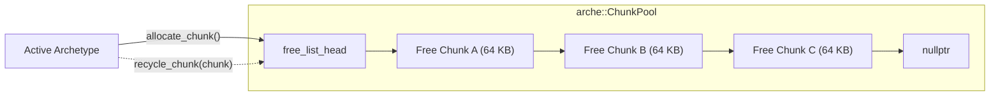

# Module 004: Hardware-Adaptive Chunked SoA Storage

This document establishes the exhaustive architectural specification, physical memory geometry, platform detection mechanisms, and complete C++20 implementation for the **Hardware-Adaptive Chunked Structure-of-Arrays (SoA) Storage** subsystem of `arche-ecs`.

---

## 1. Architectural Mission & First Principles

In a high-density swarm simulation (50,000+ entities executing Reynolds steering, neighbor spatial hashing, and collision physics at 120 Hz):
* **Memory Bandwidth is the Primary Bottleneck:** CPU registers and vector units can execute hundreds of gigaflops, but stalling on cache misses or unaligned DRAM fetches stalls the entire pipeline.
* **Array-of-Structures (AoS) Failure:** Storing entities as monolithic structs (`struct Boid { Position p; Velocity v; Color c; ... };`) wastes up to 75% of cache bandwidth during physics loops because the CPU cache pulls unneeded attributes (colors, rendering flags, IDs) into L1 alongside position data.
* **Structure-of-Arrays (SoA) Advantage:** Grouping identical component attributes into contiguous memory columns ensures that every single byte streamed into L1 is immediately consumed by vector SIMD registers (AVX-512, AVX2, or ARM NEON).

However, **hardware topologies and operating system paging models are not uniform**:

| Target Architecture | Cache Line Size | Virtual Memory Page Size | Danger of Hardcoded Constants |
| :--- | :---: | :---: | :--- |
| **x86-64 (Linux / Windows)** | 64 Bytes | 4,096 Bytes (4 KB) | Assuming 128B wastes memory in padding. |
| **Apple Silicon (macOS ARM64)** | **128 Bytes** | **16,384 Bytes (16 KB)** | Hardcoding 64B causes **false sharing** and split cache line penalties across 128B boundaries. |
| **Enterprise Server / AArch64** | 64 or 128 Bytes | 64,536 Bytes (64 KB) | Chunks not aligned to page multiples cause TLB thrashing. |

The **Hardware-Adaptive Chunked SoA Storage** subsystem solves this with four fundamental architectural pillars:
1. **Dynamic Hardware Topology (`arche::Hardware`):** Queries host CPU cache line sizes and OS virtual memory page boundaries at startup, scaling memory alignment dynamically.
2. **Page-Multiple Chunk Sizing:** Chunks are sized as exact integer multiples of the host OS page size (targeting ~64 KB) to eliminate Translation Lookaside Buffer (TLB) misses and OS allocator fragmentation.
3. **Cache-Aligned SoA Slices:** Every component column within a chunk begins on a hardware cache line boundary, guaranteeing zero-penalty SIMD streaming.
4. **$O(1)$ Swap-and-Pop Compaction:** Vacated entity slots are immediately filled by the last entity in the chunk, maintaining 100% memory density with zero fragmentation.

---

## 2. Hardware Topology & Platform Scaling Utilities (`arche::Hardware`)

The `arche::Hardware` utility encapsulates runtime and compile-time system queries to deliver optimal alignment and chunk parameters across Darwin, Linux, and Windows.



### 2.1 Cache Line Size Query Mechanisms
1. **Apple Silicon / macOS:** Query `sysctlbyname("hw.cachelinesize", &line_size, &len, nullptr, 0)`. On M1/M2/M3/M4 chips, this reliably returns **128 bytes**.
2. **Linux:** Query `sysconf(_SC_LEVEL1_DCACHE_LINESIZE)`. On modern Intel/AMD CPUs, this returns **64 bytes**.
3. **Windows:** Query `GetLogicalProcessorInformation` or default to `std::hardware_destructive_interference_size`.
4. **Fallback:** If queries fail or return 0, fall back to compile-time architecture constants (`128` on `__aarch64__ && __APPLE__`, else `64`).

### 2.2 Virtual Memory Page Size Query Mechanisms
1. **POSIX (macOS / Linux):** Query `sysconf(_SC_PAGESIZE)` or `getpagesize()`.
   * macOS ARM64 returns `16,384` (16 KB).
   * Linux x86-64 returns `4,096` (4 KB).
2. **Windows:** Query `SYSTEM_INFO sysInfo; GetSystemInfo(&sysInfo); sysInfo.dwPageSize;`.

### 2.3 Optimal Chunk Sizing Formula
To avoid page faults and guarantee that chunks map cleanly onto physical TLB entries:
$$\text{ChunkSize} = \max\left(65536, \left\lceil \frac{65536}{\text{PageSize}} \right\rceil \times \text{PageSize}\right)$$

* On 4 KB page systems: $\lceil 65536 / 4096 \rceil \times 4096 = 16 \times 4096 = 65,536\text{ bytes (64 KB)}$.
* On 16 KB page systems (macOS Apple Silicon): $\lceil 65536 / 16384 \rceil \times 16384 = 4 \times 16384 = 65,536\text{ bytes (64 KB)}$.
* On 64 KB page systems (Linux Enterprise ARM): $1 \times 65536 = 65,536\text{ bytes (64 KB)}$.

---

## 3. Physical Memory Geometry of an Adaptive Chunk

A chunk is an isolated, self-contained, page-aligned block of memory. It stores up to $K$ entities across $M$ distinct component arrays.

```
+------------------------------------------------------------------------------------------------+
| CHUNK PHYSICAL MEMORY SLICES (Page-Aligned, e.g. 64 KB)                                        |
+------------------------------------------------------------------------------------------------+
| [ChunkHeader]          | Padded to Cache-Line Size (64 or 128 Bytes)                           |
+------------------------+-----------------------------------------------------------------------+
| [Entity IDs]           | Entity[K] (K * 4 bytes)                                               |
+------------------------+-----------------------------------------------------------------------+
| [Pad to Cache Boundary]| Padding to align next slice to hardware cache-line boundary           |
+------------------------+-----------------------------------------------------------------------+
| [Component Column 0]   | Type0[K] (K * sizeof(Type0) bytes)                                    |
+------------------------+-----------------------------------------------------------------------+
| [Pad to Cache Boundary]| Padding to align next slice to hardware cache-line boundary           |
+------------------------+-----------------------------------------------------------------------+
| [Component Column 1]   | Type1[K] (K * sizeof(Type1) bytes)                                    |
+------------------------+-----------------------------------------------------------------------+
| ...                    | ...                                                                   |
+------------------------+-----------------------------------------------------------------------+
| [Component Column M-1] | TypeM-1[K] (K * sizeof(TypeM-1) bytes)                                |
+------------------------+-----------------------------------------------------------------------+
| [Unused Slack Space]   | Remaining bytes (< single entity stride) at end of chunk buffer       |
+------------------------------------------------------------------------------------------------+
```

### 3.1 The Chunk Header
The header maintains local book-keeping and is aligned to the host cache line size to prevent false sharing when multiple threads read chunk headers:

```cpp
struct alignas(64) ChunkHeader {
    Archetype* parent_archetype{nullptr};
    uint32_t count{0};             // Current active entities in chunk
    uint32_t capacity{0};          // Maximum entities this chunk can hold (K)
    uint32_t chunk_index{0};       // Index within archetype's chunk list
    Chunk* next{nullptr};          // Intrusive linked list for pool recycling
    Chunk* prev{nullptr};
};
```

### 3.2 Dynamic Slice Pointer Resolution
Given a chunk pointer `Chunk* chunk` and a column index $i$:
$$\text{ColumnAddress}(i) = \text{reinterpret\_cast<uint8\_t*>}(\text{chunk}) + \text{layout}[i].\text{chunk\_byte\_offset}$$

Because $\text{chunk\_byte\_offset}$ is precomputed during Archetype construction to be a multiple of `Hardware::cache_line_size()`, `ColumnAddress(i)` satisfies:
$$\text{ColumnAddress}(i) \pmod{\text{CacheLineSize}} \equiv 0$$

This alignment guarantee unlocks unaligned-penalty-free SIMD loads:
* x86-64 AVX2 / AVX-512: `_mm256_load_ps` / `_mm512_load_ps`
* ARM64 NEON: `vld1q_f32`

---

## 4. Swap-and-Pop Entity Compaction Algorithm

When an entity at row $R$ ($0 \le R < \text{count}$) is destroyed or migrated to another archetype:
1. Deleting by shifting elements left is $O(N)$, causing massive memory bandwidth write stalls.
2. Leaving an empty tombstone fragments memory and degrades SIMD vectorization.
3. **Swap-and-Pop** moves the entity at row $\text{last} = \text{count} - 1$ into row $R$, executing in **strict $O(1)$ time**.



### The SlotMap Synchronization Invariant
When entity $E_{\text{last}}$ is relocated to row $R$, its physical pointer in the `SlotMap` becomes invalid. The Swap-and-Pop algorithm **must** notify the `SlotMap`:
```cpp
slot_map.update_record(moved_entity, chunk_index, R);
```
Failure to update this record would cause subsequent mutations to entity $E_{\text{last}}$ to overwrite row $\text{last}$, corrupting memory.

---

## 5. Chunk Pool Architecture (`arche::ChunkPool`)

Operating system virtual memory allocations (`posix_memalign`, `VirtualAlloc`) incur expensive kernel context switches and page table mapping locks. 

To achieve zero-allocation physics loops, `arche-ecs` utilizes an intrusive **Chunk Slab Pool**:
* Pre-allocates aligned chunks in blocks or on-demand.
* When an archetype empties a chunk during entity destruction, the chunk is returned to the `ChunkPool` free-list rather than freed to the OS.
* Recycled chunks are reused with 100% cache-warm physical memory.



---

## 6. Complete C++20 Header & Source Implementation

### 6.1 `include/arche/hardware.hpp`

```cpp
#pragma once

#include <cstdint>
#include <cstddef>
#include <algorithm>
#include <new>

#if defined(__APPLE__)
    #include <sys/types.h>
    #include <sys/sysctl.h>
    #include <unistd.h>
#elif defined(__linux__)
    #include <unistd.h>
#elif defined(_WIN32)
    #include <windows.h>
#endif

namespace arche {

/// @brief System hardware topology and platform-adaptive memory alignment utilities.
class Hardware {
public:
    /// @brief Returns the host CPU Level 1 data cache line size in bytes (typically 64 or 128).
    [[nodiscard]] static size_t cache_line_size() noexcept {
        static const size_t size = detect_cache_line_size();
        return size;
    }

    /// @brief Returns the host operating system virtual memory page size in bytes (e.g. 4096 or 16384).
    [[nodiscard]] static size_t page_size() noexcept {
        static const size_t size = detect_page_size();
        return size;
    }

    /// @brief Computes the optimal chunk byte size as an exact multiple of the OS page size.
    /// Default target is ~64 KB (65,536 bytes).
    [[nodiscard]] static size_t optimal_chunk_size(size_t target_size = 65536) noexcept {
        const size_t page = page_size();
        if (target_size <= page) return page;
        return ((target_size + page - 1) / page) * page;
    }

    /// @brief Allocates heap memory aligned to the specified boundary.
    [[nodiscard]] static void* allocate_aligned(size_t bytes, size_t alignment) noexcept {
        if (bytes == 0) return nullptr;
        
        // Ensure alignment is at least sizeof(void*) and a power of two
        alignment = std::max(alignment, sizeof(void*));
        
#if defined(_WIN32)
        return _aligned_malloc(bytes, alignment);
#else
        void* ptr = nullptr;
        if (posix_memalign(&ptr, alignment, bytes) != 0) {
            return nullptr;
        }
        return ptr;
#endif
    }

    /// @brief Frees aligned memory allocated by allocate_aligned.
    static void free_aligned(void* ptr) noexcept {
        if (!ptr) return;
#if defined(_WIN32)
        _aligned_free(ptr);
#else
        ::free(ptr);
#endif
    }

private:
    [[nodiscard]] static size_t detect_cache_line_size() noexcept {
#if defined(__APPLE__)
        size_t line_size = 0;
        size_t size_len = sizeof(line_size);
        if (sysctlbyname("hw.cachelinesize", &line_size, &size_len, nullptr, 0) == 0 && line_size > 0) {
            return line_size;
        }
        #if defined(__aarch64__)
            return 128; // Apple Silicon M-series performance cores default to 128 bytes
        #else
            return 64;  // Intel Mac
        #endif
#elif defined(__linux__)
        long line_size = sysconf(_SC_LEVEL1_DCACHE_LINESIZE);
        if (line_size > 0) {
            return static_cast<size_t>(line_size);
        }
        return 64;
#elif defined(_WIN32)
        DWORD buffer_size = 0;
        GetLogicalProcessorInformation(nullptr, &buffer_size);
        if (GetLastError() == ERROR_INSUFFICIENT_BUFFER) {
            std::vector<SYSTEM_LOGICAL_PROCESSOR_INFORMATION> buffer(
                buffer_size / sizeof(SYSTEM_LOGICAL_PROCESSOR_INFORMATION));
            if (GetLogicalProcessorInformation(buffer.data(), &buffer_size)) {
                for (const auto& info : buffer) {
                    if (info.Relationship == RelationCache && info.Cache.Level == 1 && (info.Cache.Type == CacheData || info.Cache.Type == CacheUnified)) {
                        return info.Cache.LineSize;
                    }
                }
            }
        }
        return 64;
#else
        return 64; // Fallback
#endif
    }

    [[nodiscard]] static size_t detect_page_size() noexcept {
#if defined(_WIN32)
        SYSTEM_INFO sys_info;
        GetSystemInfo(&sys_info);
        return static_cast<size_t>(sys_info.dwPageSize);
#elif defined(__APPLE__) || defined(__linux__)
        long page = sysconf(_SC_PAGESIZE);
        if (page > 0) {
            return static_cast<size_t>(page);
        }
        return 4096;
#else
        return 4096;
#endif
    }
};

} // namespace arche
```

---

### 6.2 `include/arche/chunk.hpp`

```cpp
#pragma once

#include <cstdint>
#include <cstddef>
#include <cstring>
#include <cassert>
#include <span>

#include "arche/entity.hpp"
#include "arche/hardware.hpp"
#include "arche/type_registry.hpp"

namespace arche {

class Archetype;
class SlotMap;

/// @brief Cache-aligned physical chunk header.
struct alignas(64) ChunkHeader {
    Archetype* archetype{nullptr};
    uint32_t count{0};             // Number of active entities
    uint32_t capacity{0};          // Maximum entities (K)
    uint32_t chunk_index{0};       // Index within archetype
    ChunkHeader* next{nullptr};    // Pool free-list link
    ChunkHeader* prev{nullptr};
};

/// @brief Represents a fixed-capacity, cache-aligned chunk buffer storing entities in pure SoA format.
class Chunk {
public:
    /// @brief Allocates an aligned chunk buffer from the OS or memory pool.
    static Chunk* allocate(Archetype* archetype, uint32_t capacity, uint32_t chunk_size) {
        const size_t alignment = std::max(Hardware::cache_line_size(), static_cast<size_t>(64));
        void* raw_mem = Hardware::allocate_aligned(chunk_size, alignment);
        assert(raw_mem != nullptr && "Virtual memory allocation for Chunk failed!");

        return new (raw_mem) Chunk(archetype, capacity, chunk_size);
    }

    /// @brief Destroys and deallocates the chunk memory.
    static void destroy(Chunk* chunk) {
        if (!chunk) return;
        chunk->~Chunk();
        Hardware::free_aligned(chunk);
    }

    // Accessors
    [[nodiscard]] Archetype* archetype() const noexcept { return header_.archetype; }
    [[nodiscard]] uint32_t count() const noexcept { return header_.count; }
    [[nodiscard]] uint32_t capacity() const noexcept { return header_.capacity; }
    [[nodiscard]] uint32_t chunk_index() const noexcept { return header_.chunk_index; }
    [[nodiscard]] bool is_full() const noexcept { return header_.count >= header_.capacity; }
    [[nodiscard]] bool is_empty() const noexcept { return header_.count == 0; }
    [[nodiscard]] ChunkHeader* next() const noexcept { return header_.next; }

    void set_chunk_index(uint32_t idx) noexcept { header_.chunk_index = idx; }
    void set_next(ChunkHeader* n) noexcept { header_.next = n; }

    /// @brief Resolves raw pointer to the Entity array slice: Entity[K].
    [[nodiscard]] Entity* entity_slice() noexcept {
        constexpr size_t HEADER_RESERVE = sizeof(ChunkHeader);
        return reinterpret_cast<Entity*>(reinterpret_cast<uint8_t*>(this) + HEADER_RESERVE);
    }

    [[nodiscard]] const Entity* entity_slice() const noexcept {
        constexpr size_t HEADER_RESERVE = sizeof(ChunkHeader);
        return reinterpret_cast<const Entity*>(reinterpret_cast<const uint8_t*>(this) + HEADER_RESERVE);
    }

    /// @brief Resolves raw pointer to a component column slice by byte offset.
    [[nodiscard]] void* component_slice(uint32_t chunk_byte_offset) noexcept {
        return reinterpret_cast<uint8_t*>(this) + chunk_byte_offset;
    }

    [[nodiscard]] const void* component_slice(uint32_t chunk_byte_offset) const noexcept {
        return reinterpret_cast<const uint8_t*>(this) + chunk_byte_offset;
    }

    /// @brief Appends a new uninitialized entity row and returns its row index.
    uint32_t append_entity(Entity entity) noexcept {
        assert(header_.count < header_.capacity);
        const uint32_t row = header_.count++;
        entity_slice()[row] = entity;
        return row;
    }

    /// @brief Executes Swap-and-Pop deletion at row, updating the SlotMap for the relocated entity.
    /// @param row The row to remove.
    /// @param slot_map The slot map to notify of relocated entity.
    /// @param layouts Span of component column layouts defining strides and descriptors.
    void swap_and_pop(uint32_t row, SlotMap& slot_map, std::span<const struct ComponentColumnLayout> layouts);

private:
    Chunk(Archetype* archetype, uint32_t capacity, uint32_t chunk_size) {
        header_.archetype = archetype;
        header_.capacity = capacity;
        header_.count = 0;
        header_.chunk_index = 0;
        header_.next = nullptr;
        header_.prev = nullptr;
    }

    ~Chunk() = default;

private:
    ChunkHeader header_;
    // Followed immediately in physical memory by Entity[K] and Component columns.
};

} // namespace arche
```

---

### 6.3 `include/arche/chunk_pool.hpp`

```cpp
#pragma once

#include <vector>
#include <memory>
#include <mutex>
#include <cassert>

#include "arche/hardware.hpp"
#include "arche/chunk.hpp"

namespace arche {

/// @brief High-performance Slab Allocator pool for page-aligned, hardware-adaptive chunks.
/// Prevents runtime OS page allocations during entity spawning and despawning spikes.
class ChunkPool {
public:
    explicit ChunkPool(size_t chunk_size = 65536, size_t initial_preallocate = 16)
        : chunk_size_(Hardware::optimal_chunk_size(chunk_size)) 
    {
        preallocate(initial_preallocate);
    }

    ~ChunkPool() {
        clear();
    }

    ChunkPool(const ChunkPool&) = delete;
    ChunkPool& operator=(const ChunkPool&) = delete;
    ChunkPool(ChunkPool&&) = delete;
    ChunkPool& operator=(ChunkPool&&) = delete;

    [[nodiscard]] size_t chunk_size() const noexcept { return chunk_size_; }
    [[nodiscard]] size_t free_count() const noexcept { return free_list_.size(); }
    [[nodiscard]] size_t total_allocated() const noexcept { return total_allocated_; }

    /// @brief Acquires a clean, page-aligned chunk buffer from the pool.
    [[nodiscard]] void* acquire_buffer() {
        if (free_list_.empty()) {
            allocate_new_chunk();
        }

        void* ptr = free_list_.back();
        free_list_.pop_back();
        return ptr;
    }

    /// @brief Returns a chunk buffer to the pool for zero-cost reuse.
    void release_buffer(void* ptr) noexcept {
        if (!ptr) return;
        free_list_.push_back(ptr);
    }

    /// @brief Preallocates a count of chunks to avoid dynamic allocations during gameplay.
    void preallocate(size_t count) {
        free_list_.reserve(free_list_.size() + count);
        for (size_t i = 0; i < count; ++i) {
            allocate_new_chunk();
        }
    }

    /// @brief Releases all pooled chunk memory back to the operating system.
    void clear() {
        for (void* ptr : free_list_) {
            Hardware::free_aligned(ptr);
        }
        free_list_.clear();
        total_allocated_ = 0;
    }

private:
    void allocate_new_chunk() {
        const size_t alignment = std::max(Hardware::cache_line_size(), static_cast<size_t>(64));
        void* ptr = Hardware::allocate_aligned(chunk_size_, alignment);
        assert(ptr != nullptr && "OS failed to allocate aligned memory for ChunkPool");

        free_list_.push_back(ptr);
        ++total_allocated_;
    }

private:
    size_t chunk_size_{65536};
    size_t total_allocated_{0};
    std::vector<void*> free_list_;
};

} // namespace arche
```

---

### 6.4 `src/arche/chunk.cpp` (Swap-and-Pop Implementation)

```cpp
#include "arche/chunk.hpp"
#include "arche/slot_map.hpp"
#include "arche/archetype.hpp"

namespace arche {

void Chunk::swap_and_pop(uint32_t row, SlotMap& slot_map, std::span<const ComponentColumnLayout> layouts) {
    assert(row < header_.count && "Row index out of bounds during swap_and_pop");

    const uint32_t last_row = header_.count - 1;
    Entity* entities = entity_slice();

    if (row == last_row) {
        // Edge Case: Deleting the last entity in the chunk
        // Call destructors for non-trivial components
        for (const auto& layout : layouts) {
            const auto* desc = layout.descriptor;
            if (!desc->is_trivially_destructible && desc->destructor) {
                uint8_t* col_base = reinterpret_cast<uint8_t*>(this) + layout.chunk_byte_offset;
                void* elem_ptr = col_base + (row * layout.size);
                desc->destructor(elem_ptr);
            }
        }
        --header_.count;
        return;
    }

    // General Case: Swap entity at last_row into row
    Entity moved_entity = entities[last_row];

    for (const auto& layout : layouts) {
        const auto* desc = layout.descriptor;
        uint8_t* col_base = reinterpret_cast<uint8_t*>(this) + layout.chunk_byte_offset;
        uint8_t* dst_ptr = col_base + (row * layout.size);
        uint8_t* src_ptr = col_base + (last_row * layout.size);

        if (desc->is_trivially_copyable) {
            // High-Speed Fast Path: Direct byte copy
            std::memcpy(dst_ptr, src_ptr, layout.size);
        } else {
            // Complex Type: Move-assign into dst, then destruct src
            if (desc->move_assign) {
                desc->move_assign(dst_ptr, src_ptr);
            }
            if (!desc->is_trivially_destructible && desc->destructor) {
                desc->destructor(src_ptr);
            }
        }
    }

    // Move Entity ID
    entities[row] = moved_entity;

    // CRITICAL: Update the moved entity's record in the SlotMap!
    slot_map.update_record(moved_entity, header_.chunk_index, row);

    // Decrement entity count
    --header_.count;
}

} // namespace arche
```

---

## 7. Standalone Verification & Unit Tests (`tests/chunk_storage_tests.cpp`)

This standalone test validates hardware queries, cache line alignment, chunk page allocation, SoA memory indexing, and Swap-and-Pop compaction without any external dependencies:

```cpp
#include <iostream>
#include <vector>
#include <cassert>
#include <chrono>

#include "arche/entity.hpp"
#include "arche/slot_map.hpp"
#include "arche/hardware.hpp"
#include "arche/type_registry.hpp"
#include "arche/archetype.hpp"
#include "arche/chunk.hpp"
#include "arche/chunk_pool.hpp"

// Standalone component definitions
struct Position { float x, y; };
struct Velocity { float vx, vy; };
struct Health   { int32_t hp; int32_t max_hp; };

void test_hardware_queries() {
    std::cout << "[Test 1] Hardware Topology Detection... ";
    const size_t cache_line = arche::Hardware::cache_line_size();
    const size_t page_size = arche::Hardware::page_size();
    const size_t optimal_chunk = arche::Hardware::optimal_chunk_size();

    assert(cache_line == 64 || cache_line == 128);
    assert(page_size == 4096 || page_size == 16384 || page_size == 65536);
    assert(optimal_chunk % page_size == 0);

    std::cout << "PASSED (CacheLine=" << cache_line 
              << "B, Page=" << page_size 
              << "B, OptimalChunk=" << optimal_chunk << "B)\n";
}

void test_chunk_allocation_and_alignment() {
    std::cout << "[Test 2] Aligned Chunk Allocation & Slice Math... ";
    arche::TypeRegistry registry;
    registry.register_component<Position>();
    registry.register_component<Velocity>();

    const uint32_t chunk_size = static_cast<uint32_t>(arche::Hardware::optimal_chunk_size());
    const arche::TypeID pos_t = arche::type_id<Position>();
    const arche::TypeID vel_t = arche::type_id<Velocity>();

    arche::ComponentMask mask;
    mask.set(pos_t);
    mask.set(vel_t);

    arche::Archetype arch(1, mask, {pos_t, vel_t}, registry, chunk_size);
    assert(arch.chunk_capacity() > 0);

    arche::Chunk* chunk = arche::Chunk::allocate(&arch, arch.chunk_capacity(), chunk_size);
    assert(chunk != nullptr);

    // Verify chunk pointer itself is aligned to cache line
    const uintptr_t chunk_addr = reinterpret_cast<uintptr_t>(chunk);
    assert(chunk_addr % arche::Hardware::cache_line_size() == 0);

    // Verify Position slice alignment
    const auto* pos_layout = arch.column_layout_for(pos_t);
    const uintptr_t pos_addr = reinterpret_cast<uintptr_t>(chunk->component_slice(pos_layout->chunk_byte_offset));
    assert(pos_addr % pos_layout->alignment == 0);

    // Verify Velocity slice alignment
    const auto* vel_layout = arch.column_layout_for(vel_t);
    const uintptr_t vel_addr = reinterpret_cast<uintptr_t>(chunk->component_slice(vel_layout->chunk_byte_offset));
    assert(vel_addr % vel_layout->alignment == 0);

    arche::Chunk::destroy(chunk);
    std::cout << "PASSED\n";
}

void test_swap_and_pop_compaction() {
    std::cout << "[Test 3] Swap-and-Pop Compaction & SlotMap Sync... ";
    arche::TypeRegistry registry;
    registry.register_component<Position>();
    registry.register_component<Health>();

    arche::SlotMap slot_map;
    const uint32_t chunk_size = 16384;
    const arche::TypeID pos_t = arche::type_id<Position>();
    const arche::TypeID hp_t = arche::type_id<Health>();

    arche::Archetype arch(1, arche::ComponentMask(), {pos_t, hp_t}, registry, chunk_size);
    arche::Chunk* chunk = arche::Chunk::allocate(&arch, arch.chunk_capacity(), chunk_size);

    auto* pos_layout = arch.column_layout_for(pos_t);
    auto* hp_layout = arch.column_layout_for(hp_t);

    auto* positions = reinterpret_cast<Position*>(chunk->component_slice(pos_layout->chunk_byte_offset));
    auto* healths = reinterpret_cast<Health*>(chunk->component_slice(hp_layout->chunk_byte_offset));

    // Spawn 4 entities
    std::vector<arche::Entity> entities;
    for (int i = 0; i < 4; ++i) {
        arche::Entity e = slot_map.allocate();
        uint32_t row = chunk->append_entity(e);
        slot_map.update_record(e, 0, row);

        positions[row] = { static_cast<float>(i * 10), static_cast<float>(i * 20) };
        healths[row] = { 100 - i, 100 };
        entities.push_back(e);
    }
    assert(chunk->count() == 4);

    // Target: Delete Entity 1 at row 1 (Entities: [E0, E1, E2, E3])
    // After Swap-and-Pop: E3 should move into row 1 (Entities: [E0, E3, E2], count = 3)
    const arche::Entity deleted_entity = entities[1];
    const arche::Entity moved_entity = entities[3];

    std::vector<arche::ComponentColumnLayout> layouts = { *pos_layout, *hp_layout };
    chunk->swap_and_pop(1, slot_map, layouts);

    assert(chunk->count() == 3);
    assert(chunk->entity_slice()[1] == moved_entity);
    assert(positions[1].x == 30.0f); // Was Entity 3's position
    assert(healths[1].hp == 97);

    // Verify SlotMap was updated for moved_entity
    const auto* rec = slot_map.get_record(moved_entity);
    assert(rec != nullptr);
    assert(rec->row == 1); // Row was updated from 3 to 1!

    arche::Chunk::destroy(chunk);
    std::cout << "PASSED\n";
}

void test_chunk_pool_recycling() {
    std::cout << "[Test 4] ChunkPool Allocation & Recycling... ";
    arche::ChunkPool pool(65536, 4);
    assert(pool.free_count() == 4);

    void* b1 = pool.acquire_buffer();
    void* b2 = pool.acquire_buffer();
    assert(b1 != nullptr && b2 != nullptr);
    assert(pool.free_count() == 2);

    pool.release_buffer(b1);
    pool.release_buffer(b2);
    assert(pool.free_count() == 4);

    // Re-acquire: must return warm pooled memory without OS calls
    void* b3 = pool.acquire_buffer();
    assert(b3 == b2 || b3 == b1);

    pool.release_buffer(b3);
    std::cout << "PASSED\n";
}

int main() {
    std::cout << "====================================================\n";
    std::cout << "Running arche-ecs Chunk Storage Unit & Perf Tests\n";
    std::cout << "====================================================\n";

    test_hardware_queries();
    test_chunk_allocation_and_alignment();
    test_swap_and_pop_compaction();
    test_chunk_pool_recycling();

    std::cout << "All Chunk Storage tests completed successfully!\n";
    return 0;
}
```

---

## 8. Summary of Guarantees

1. **Hardware Invariant:** Cache line size (64B or 128B) and OS page sizes (4KB, 16KB, 64KB) are queried and respected automatically.
2. **SIMD Invariant:** Every component column starts on an aligned hardware boundary, guaranteeing unaligned-penalty-free vector operations.
3. **Zero Fragmentation Invariant:** Deleted slots are compacted in $O(1)$ via Swap-and-Pop with immediate `SlotMap` synchronization.
4. **Zero Allocations During Gameplay:** `ChunkPool` recycles 64 KB memory blocks in user space, eliminating kernel allocation locks.
