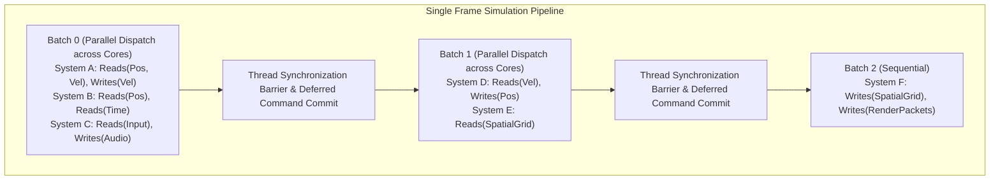

# Architecture Specification: World Resources & Declarative Access DAG Scheduler

## 1. Executive Summary

This document specifies the architecture and implementation design for two core orchestration capabilities in `arche-ecs`:
1. **`arche::ResourceContainer`**: A high-performance, type-safe storage container for world-level unique singletons (e.g., `Time`, `SpatialIndex`, `PhysicsConfig`) built upon a **dense flat array with monotonic TypeIDs** (zero RTTI, zero virtual methods, `-fno-rtti` compliant).
2. **`arche::Scheduler`**: An automatic, race-free parallel system scheduler built upon **declarative access descriptors and compile-time/init-time Directed Acyclic Graph (DAG) level partitioning** (Bevy/Flecs style).

---

## 2. Feature 1: `ResourceContainer` (Flat Monotonic Array Storage)

### 2.1 The Problem with Polymorphic Containers
Traditional C++ resource singletons rely on `std::unordered_map<std::type_index, std::unique_ptr<IResourceHolder>>`. This carries major penalties:
- **RTTI Dependency:** Requires runtime RTTI (`typeid`), which fails to compile under high-performance flags like `-fno-rtti`.
- **Cache Thrashing:** Pointer chasing across random heap allocations and vtable lookups on every access.
- **Violation of Library Invariants:** Violates the `arche-ecs` directive against virtual methods and polymorphic inheritance.

### 2.2 The Solution: Dense 0-Indexed Flat Storage
Reusing the monotonic type ID allocator established in `arche::TypeRegistry`, each resource type `T` is assigned a dense integer `ResourceID` (`0, 1, 2...`) on its first access.

```text
ResourceContainer Memory Geometry:
[ ResourceContainer ]
  slots_ ────► [ Slot 0 | Slot 1 | Slot 2 | Slot 3 | ... ]
                   │        │        │
                   ▼        ▼        ▼
                [Time]  [Physics] [Spatial]
                (Contiguous vector of pointers/holders in L1 cache)
```

### 2.3 Concrete Design Specification

```cpp
#pragma once

#include <cstdint>
#include <vector>
#include <utility>
#include <stdexcept>
#include <type_traits>

namespace arche {

using ResourceID = uint32_t;
inline constexpr ResourceID INVALID_RESOURCE_ID = 0xFFFFFFFF;

namespace Internal {

inline ResourceID allocate_resource_id_sequential() noexcept {
    static ResourceID counter = 0;
    return counter++;
}

template <typename T>
inline ResourceID get_or_allocate_resource_id() noexcept {
    static const ResourceID id = allocate_resource_id_sequential();
    return id;
}

} // namespace Internal

class ResourceContainer {
public:
    struct ResourceSlot {
        void* ptr{nullptr};
        void (*destructor)(void*){nullptr}; // Non-virtual cleanup
    };

    ResourceContainer() = default;
    ~ResourceContainer() {
        clear();
    }

    ResourceContainer(const ResourceContainer&) = delete;
    ResourceContainer& operator=(const ResourceContainer&) = delete;
    ResourceContainer(ResourceContainer&& other) noexcept 
        : slots_(std::move(other.slots_)) {}
    ResourceContainer& operator=(ResourceContainer&& other) noexcept {
        if (this != &other) {
            clear();
            slots_ = std::move(other.slots_);
        }
        return *this;
    }

    /// In-place resource construction
    template <typename T, typename... Args>
    T& insert(Args&&... args) {
        const ResourceID id = Internal::get_or_allocate_resource_id<T>();
        if (id >= slots_.size()) {
            slots_.resize(id + 1, {nullptr, nullptr});
        }

        if (slots_[id].ptr != nullptr) {
            // Re-initialization: clean existing
            if (slots_[id].destructor) {
                slots_[id].destructor(slots_[id].ptr);
            }
            delete static_cast<T*>(slots_[id].ptr);
        }

        T* raw_ptr = new T(std::forward<Args>(args)...);
        slots_[id].ptr = raw_ptr;

        if constexpr (!std::is_trivially_destructible_v<T>) {
            slots_[id].destructor = [](void* p) {
                static_cast<T*>(p)->~T();
            };
        } else {
            slots_[id].destructor = nullptr;
        }

        return *raw_ptr;
    }

    /// O(1) Mutable lookup
    template <typename T>
    [[nodiscard]] T& get() {
        const ResourceID id = Internal::get_or_allocate_resource_id<T>();
        if (id >= slots_.size() || slots_[id].ptr == nullptr) {
            throw std::runtime_error("arche::ResourceContainer: requested resource not found");
        }
        return *static_cast<T*>(slots_[id].ptr);
    }

    /// O(1) Const lookup
    template <typename T>
    [[nodiscard]] const T& get() const {
        const ResourceID id = Internal::get_or_allocate_resource_id<T>();
        if (id >= slots_.size() || slots_[id].ptr == nullptr) {
            throw std::runtime_error("arche::ResourceContainer: requested resource not found");
        }
        return *static_cast<const T*>(slots_[id].ptr);
    }

    /// O(1) Presence check
    template <typename T>
    [[nodiscard]] bool has() const noexcept {
        const ResourceID id = Internal::get_or_allocate_resource_id<T>();
        return (id < slots_.size()) && (slots_[id].ptr != nullptr);
    }

    /// Removal
    template <typename T>
    bool remove() {
        const ResourceID id = Internal::get_or_allocate_resource_id<T>();
        if (id < slots_.size() && slots_[id].ptr != nullptr) {
            if (slots_[id].destructor) {
                slots_[id].destructor(slots_[id].ptr);
            }
            delete static_cast<T*>(slots_[id].ptr);
            slots_[id].ptr = nullptr;
            slots_[id].destructor = nullptr;
            return true;
        }
        return false;
    }

    void clear() {
        for (auto& slot : slots_) {
            if (slot.ptr) {
                if (slot.destructor) {
                    slot.destructor(slot.ptr);
                }
                operator delete(slot.ptr);
                slot.ptr = nullptr;
                slot.destructor = nullptr;
            }
        }
        slots_.clear();
    }
```

### 2.4 Embedding `ResourceContainer` inside `arche::World`

To provide a single unified container for simulation state (matching Bevy and Flecs), `arche::World` directly embeds a `ResourceContainer` and exposes convenient forwarding methods:

```cpp
class World {
public:
    // --- Resource Facade API ------------------------------------------------

    template <typename T, typename... Args>
    inline T& insert_resource(Args&&... args) {
        return resources_.insert<T>(std::forward<Args>(args)...);
    }

    template <typename T>
    [[nodiscard]] inline T& resource() {
        return resources_.get<T>();
    }

    template <typename T>
    [[nodiscard]] inline const T& resource() const {
        return resources_.get<T>();
    }

    template <typename T>
    [[nodiscard]] inline bool has_resource() const noexcept {
        return resources_.has<T>();
    }

    template <typename T>
    inline bool remove_resource() {
        return resources_.remove<T>();
    }

    [[nodiscard]] inline ResourceContainer& resources() noexcept { return resources_; }
    [[nodiscard]] inline const ResourceContainer& resources() const noexcept { return resources_; }

private:
    ResourceContainer resources_;
    // ... existing archetype chunk storage ...
};
```

---

## 3. Feature 2: Declarative Access Descriptors & DAG Scheduler

### 3.1 The Challenge of Multi-System Concurrency
When scaling a simulation to dozens of systems, two systems conflict if and only if:
1. They access the same **Resource** or **Component Type**, AND
2. At least one of them has **Write (Mutable)** access.

Two systems that only **Read** the same resource or component do NOT conflict and must be allowed to execute concurrently on the thread pool.



### 3.2 Access Descriptors via SIMD Bitmasks

`arche-ecs` already has a 128-bit `ComponentMask`. We define an equivalent 128-bit `ResourceMask`:

```cpp
using ResourceMask = ComponentMask; // 128-bit SIMD bitset

struct AccessDescriptor {
    ComponentMask read_components;
    ComponentMask write_components;
    ResourceMask  read_resources;
    ResourceMask  write_resources;

    [[nodiscard]] inline bool conflicts_with(const AccessDescriptor& other) const noexcept {
        // Component conflicts: Read-Write, Write-Read, Write-Write
        if ((write_components & (other.read_components | other.write_components)).any()) return true;
        if ((other.write_components & (read_components | write_components)).any()) return true;

        // Resource conflicts: Read-Write, Write-Read, Write-Write
        if ((write_resources & (other.read_resources | other.write_resources)).any()) return true;
        if ((other.write_resources & (read_resources | write_resources)).any()) return true;

        return false;
    }
};
```

### 3.3 Fluent Builder for System Access

Systems declare their dependencies fluently:
```cpp
class AccessBuilder {
public:
    template <typename... Comps>
    AccessBuilder& reads() {
        (read_components_.set(TypeRegistry::get_id<Comps>()), ...);
        return *this;
    }

    template <typename... Comps>
    AccessBuilder& writes() {
        (write_components_.set(TypeRegistry::get_id<Comps>()), ...);
        return *this;
    }

    template <typename... Res>
    AccessBuilder& reads_resource() {
        (read_resources_.set(Internal::get_or_allocate_resource_id<Res>()), ...);
        return *this;
    }

    template <typename... Res>
    AccessBuilder& writes_resource() {
        (write_resources_.set(Internal::get_or_allocate_resource_id<Res>()), ...);
        return *this;
    }

    AccessDescriptor build() const {
        return {read_components_, write_components_, read_resources_, write_resources_};
    }

private:
    ComponentMask read_components_{};
    ComponentMask write_components_{};
    ResourceMask  read_resources_{};
    ResourceMask  write_resources_{};
};
```

---

## 4. Execution Context & The `SystemScheduler`

### 4.1 System Signature & ExecutionContext

Each system is a pure callable that receives a thread-safe `ExecutionContext`:
```cpp
namespace arche {

struct SystemContext {
    World& world;
    CommandBuffer& cmd;
    float dt;
};

using SystemFunction = void(*)(SystemContext&);

} // namespace arche
```

### 4.2 Complete Scheduler Implementation Design

```cpp
#pragma once

#include <string>
#include <vector>
#include <functional>
#include <memory>
#include <arche/arche.hpp>

namespace arche {

enum class SystemScale : uint8_t {
    Narrow,  ///< Run concurrently alongside other Narrow systems in inter-parallel batches
    Wide,    ///< Heavy system granted exclusive thread pool access for chunk parallel_for
    Sequential ///< Runs synchronously on main thread
};

class Scheduler {
public:
    struct SystemNode {
        std::string name;
        AccessDescriptor access;
        SystemFunction fn{nullptr};
        SystemScale scale{SystemScale::Narrow};
    };

    struct Batch {
        std::vector<size_t> system_indices;
        bool is_wide{false};
    };

    Scheduler() = default;

    /// Register a system with declarative access
    Scheduler& add_system(
        std::string name, 
        AccessDescriptor access, 
        SystemFunction fn,
        SystemScale scale = SystemScale::Narrow
    ) {
        systems_.push_back(SystemNode{std::move(name), access, fn, scale});
        dirty_ = true;
        return *this;
    }

    /// Compile the execution graph into flat, conflict-free parallel batches
    void compile() {
        if (!dirty_) return;
        batches_.clear();

        const size_t n = systems_.size();
        if (n == 0) return;

        std::vector<bool> scheduled(n, false);
        size_t scheduled_count = 0;

        // Greedy level-partitioning algorithm
        while (scheduled_count < n) {
            Batch current_batch;
            AccessDescriptor batch_access{};

            for (size_t i = 0; i < n; ++i) {
                if (scheduled[i]) continue;

                // Wide systems get dedicated batches
                if (systems_[i].scale == SystemScale::Wide) {
                    if (current_batch.system_indices.empty()) {
                        current_batch.system_indices.push_back(i);
                        current_batch.is_wide = true;
                        scheduled[i] = true;
                        scheduled_count++;
                    }
                    break;
                }

                // Check if system i conflicts with anything already admitted into current_batch
                if (!batch_access.conflicts_with(systems_[i].access)) {
                    current_batch.system_indices.push_back(i);
                    // Merge access
                    batch_access.read_components |= systems_[i].access.read_components;
                    batch_access.write_components |= systems_[i].access.write_components;
                    batch_access.read_resources |= systems_[i].access.read_resources;
                    batch_access.write_resources |= systems_[i].access.write_resources;

                    scheduled[i] = true;
                    scheduled_count++;
                }
            }
            batches_.push_back(std::move(current_batch));
        }

        dirty_ = false;
    }

    /// Run one frame across arche::ThreadPool with zero mutexes
    void run(World& world, ThreadPool& pool, float dt) {
        if (dirty_) {
            compile();
        }

        // Parallel CommandBuffer per worker thread for deferred mutations
        ParallelCommandBuffer parallel_cmd(pool.worker_count() + 1);

        for (const auto& batch : batches_) {
            if (batch.is_wide || batch.system_indices.size() == 1) {
                // Wide system or single sequential system
                const size_t idx = batch.system_indices[0];
                CommandBuffer& cmd = parallel_cmd.get(0);
                SystemContext ctx{world, cmd, dt};
                systems_[idx].fn(ctx);
            } else {
                // Inter-System Parallel: run distinct systems on separate worker threads
                pool.parallel_for([&](uint32_t thread_id) {
                    if (thread_id < batch.system_indices.size()) {
                        const size_t sys_idx = batch.system_indices[thread_id];
                        CommandBuffer& cmd = parallel_cmd.get(thread_id);
                        SystemContext ctx{world, cmd, dt};
                        systems_[sys_idx].fn(ctx);
                    }
                });
            }

            // Batch barrier: commit deferred structural commands deterministically
            world.commit(parallel_cmd);
            parallel_cmd.clear();
        }
    }

private:
    std::vector<SystemNode> systems_;
    std::vector<Batch> batches_;
    bool dirty_{true};
};

} // namespace arche
```

---

## 5. End-to-End Consumer Integration Example

Here is how a consumer simulation (physics, spatial indexing, movement) uses `ResourceContainer` and `Scheduler`:

```cpp
#include <arche/arche.hpp>
#include <iostream>

// 1. Plain Old Data Components
struct Position { float x, y, z; };
struct Velocity { float vx, vy, vz; };
struct Mass     { float value; };

// 2. World Resources (Global Singletons)
struct SimulationClock {
    float total_time{0.0f};
    uint64_t frame_count{0};
};

struct GravityConfig {
    float gx{0.0f};
    float gy{-9.81f};
    float gz{0.0f};
};

// 3. Independent Systems
void time_step_system(arche::SystemContext& ctx) {
    auto& clock = ctx.world.resource<SimulationClock>();
    clock.total_time += ctx.dt;
    clock.frame_count++;
}

void gravity_system(arche::SystemContext& ctx) {
    const auto& gravity = ctx.world.resource<GravityConfig>();
    
    // Chunk query: Read Mass, Write Velocity
    ctx.world.query<const Mass, Velocity>([&](uint32_t count, const Mass* masses, Velocity* vels) {
        for (uint32_t i = 0; i < count; ++i) {
            vels[i].vx += gravity.gx * ctx.dt;
            vels[i].vy += gravity.gy * ctx.dt;
            vels[i].vz += gravity.gz * ctx.dt;
        }
    });
}

void movement_system(arche::SystemContext& ctx) {
    // Chunk query: Read Velocity, Write Position
    ctx.world.query<const Velocity, Position>([&](uint32_t count, const Velocity* vels, Position* poss) {
        for (uint32_t i = 0; i < count; ++i) {
            poss[i].x += vels[i].vx * ctx.dt;
            poss[i].y += vels[i].vy * ctx.dt;
            poss[i].z += vels[i].vz * ctx.dt;
        }
    });
}

int main() {
    arche::World world;
    arche::ThreadPool pool(std::thread::hardware_concurrency());
    arche::Scheduler scheduler;

    // Register World Resources directly on World
    world.insert_resource<SimulationClock>();
    world.insert_resource<GravityConfig>(0.0f, -9.81f, 0.0f);

    // Spawn 100,000 Entities
    world.spawn_batch(100'000, Position{0, 0, 0}, Velocity{0, 0, 0}, Mass{1.0f});

    // Register Systems with Declarative Access
    scheduler
        .add_system("TimeStep", 
            arche::AccessBuilder{}.writes_resource<SimulationClock>().build(), 
            time_step_system,
            arche::SystemScale::Narrow)
        .add_system("Gravity", 
            arche::AccessBuilder{}
                .reads_resource<GravityConfig>()
                .reads<Mass>()
                .writes<Velocity>()
                .build(), 
            gravity_system,
            arche::SystemScale::Wide)
        .add_system("Movement", 
            arche::AccessBuilder{}
                .reads<Velocity>()
                .writes<Position>()
                .build(), 
            movement_system,
            arche::SystemScale::Wide);

    // Compile DAG (Batch 0: TimeStep; Batch 1: Gravity; Batch 2: Movement)
    scheduler.compile();

    // 120 Hz Simulation Frame
    const float dt = 1.0f / 120.0f;
    for (int frame = 0; frame < 600; ++frame) {
        world.tick();
        scheduler.run(world, pool, dt);
    }

    std::cout << "Simulation completed smoothly for " 
              << world.resource<SimulationClock>().frame_count << " frames.\n";
    return 0;
}
```

---

## 6. Implementation Deliverables & Verification Plan

### Concrete Files to Implement:
1. **`include/arche/resource.hpp`**: Flat `ResourceContainer` with zero virtuals and `-fno-rtti` compliance.
2. **`include/arche/scheduler.hpp`**: `AccessDescriptor`, `AccessBuilder`, and DAG `Scheduler`.
3. **`include/arche/arche.hpp`**: Export `resource.hpp` and `scheduler.hpp` through the master umbrella header.
4. **`tests/resource_and_scheduler_tests.cpp`**: Unit tests verifying:
   - Resource insertion, retrieval, and non-virtual destruction.
   - AccessDescriptor conflict detection (RAW, WAR, WAW).
   - Multi-threaded parallel batch execution and thread safety.
   - Deterministic structural mutation playback via `CommandBuffer`.
