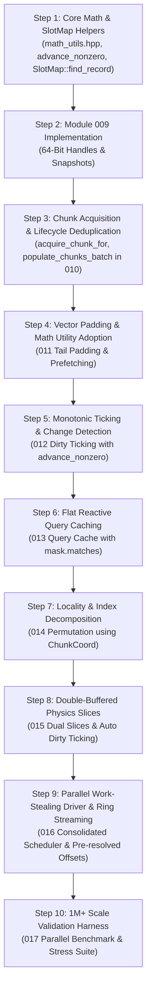

# Stage 2 Deduplication, Architectural Helpers & Documentation Modification Plan

## 1. Executive Summary & Objectives

Across the 17 specification documents of `arche-ecs` (Stage 1 modules `001`–`008` and Stage 2 modules `009`–`017`), several features, mathematical formulas, memory operations, and entity lookups were designed independently. While each module fulfills its requirements, multiple patterns recur across files or introduce redundant calculations in hot loops.

This document serves as an exhaustive, central reference consolidating **all findings from the three iterative deduplication audits**. It details:
1. The exact duplicated logic, boilerplate, and redundant calculations identified.
2. The unified helper primitives and architectural abstractions proposed to resolve them.
3. The precise, file-by-file plan for updating the documentation modules (`001`–`017`) when ready, ensuring complete cohesion, zero runtime overhead, and strict adherence to the project invariants in `GEMINI.md` (flat POD structs, zero virtual methods, and standard-library-only dependencies).

---

## 2. Catalog of Discovered Duplications & Proposed Helpers

### Category A: Mathematical Utilities, Bitwise Operations & Geometry

#### A1. Unified Bitwise Math & Alignment Header (`include/arche/math_utils.hpp`)
* **Discovered Issue:**  
  Power-of-2 alignment and bit twiddling formulas are re-implemented ad-hoc in multiple files with varying formulas:
  - Byte alignment: `(offset + align - 1) & ~(align - 1)` (`002`, `004`, `008`).
  - SIMD vector padding: `(active_count + 15) & ~15` (`011`).
  - Chunk capacity rounding: `(raw_capacity / SIMD_VECTOR_WIDTH) * SIMD_VECTOR_WIDTH` (`011`).
  - Bitset word/bit calculations: `idx / 64` and `1ULL << (idx % 64)` (`014`).
  - Ring buffer slot cycling: `ring_index % 3` (`016`).
* **Proposed Helper:**  
  Introduce `include/arche/math_utils.hpp` under namespace `arche::math`:
  ```cpp
  namespace arche::math {
    template <typename T>
    [[nodiscard]] constexpr T align_up(T val, size_t alignment) noexcept {
      return static_cast<T>((val + alignment - 1) & ~(alignment - 1));
    }

    template <size_t Width = 16, typename T>
    [[nodiscard]] constexpr T round_up_simd(T val) noexcept {
      return static_cast<T>((val + Width - 1) & ~(Width - 1));
    }

    template <size_t Width = 16, typename T>
    [[nodiscard]] constexpr T round_down_simd(T val) noexcept {
      return static_cast<T>((val / Width) * Width);
    }

    template <typename T>
    [[nodiscard]] constexpr T div_ceil(T val, T divisor) noexcept {
      return static_cast<T>((val + divisor - 1) / divisor);
    }
  }
  ```

#### A2. Multi-Chunk Index Decomposition (`ChunkCoord` & `Archetype::decompose_index`)
* **Discovered Issue:**  
  In `010` (bulk spawning), `014` (in-place cycle chasing & comparator sorting), and `017` (validation checks), translating a global entity index $g$ ($0 \le g < N$) into a chunk pointer and local row index is hand-rolled using runtime integer division and modulo (`g / cap` and `g % cap`).
* **Proposed Helper:**  
  Define a POD coordinate struct in `include/arche/archetype.hpp`:
  ```cpp
  struct ChunkCoord {
    uint32_t chunk_index{0};
    uint32_t local_row{0};
  };

  [[nodiscard]] inline ChunkCoord Archetype::decompose_index(uint32_t global_index) const noexcept {
    return { global_index / chunk_capacity_, global_index % chunk_capacity_ };
  }
  ```

#### A3. Monotonic Nonzero Wrapping Increment (`detail::advance_nonzero`)
* **Discovered Issue:**  
  Both `World::advance_tick()` (`012`) and `SlotMap::advance_generation()` (`009`) duplicate the exact same wrap-around idiom to skip sentinel value `0`:
  ```cpp
  // In World::advance_tick:
  ++current_tick_;
  if (current_tick_ == 0) current_tick_ = 1;

  // In SlotMap::advance_generation:
  const uint32_t next = gen + 1;
  return (next == 0) ? 1 : next;
  ```
* **Proposed Helper:**  
  Define in `include/arche/common.hpp` (or `entity.hpp`):
  ```cpp
  [[nodiscard]] inline constexpr uint32_t advance_nonzero(uint32_t val) noexcept {
    const uint32_t next = val + 1;
    return (next == 0) ? 1 : next;
  }
  ```

#### A4. Chunk Geometry & Boundary Validation (`ChunkGeometry`)
* **Discovered Issue:**  
  Header reserves and offsets (`sizeof(ChunkHeader)` = 64 bytes in Stage 1, 128 bytes in Module 011, 256 bytes in Module 012) and payload boundary assertions (`assert(current_offset <= chunk_size_)`) are manually maintained in `archetype.hpp` and `chunk.hpp`.
* **Proposed Helper:**  
  Add `ChunkGeometry` constexpr constants to `include/arche/chunk.hpp`:
  ```cpp
  struct ChunkGeometry {
    static constexpr size_t HEADER_BYTES = sizeof(ChunkHeader);
    static constexpr size_t PAYLOAD_BYTES = Hardware::CHUNK_SIZE - HEADER_BYTES;
  };
  ```

---

### Category B: Type System, Handle Management & SlotMap

#### B1. Automatic `std::decay_t` in `type_id<T>()`
* **Discovered Issue:**  
  In `type_registry.hpp`, `world.hpp`, `query.hpp`, `command_buffer.hpp`, and consumer calls, the syntax `type_id<std::decay_t<T>>()` is written redundantly over 40 times to strip references and const qualifiers.
* **Proposed Helper:**  
  Update `type_id<T>()` in `include/arche/type_id.hpp` to automatically decay:
  ```cpp
  template <typename T>
  [[nodiscard]] inline TypeID type_id() noexcept {
    return Internal::get_or_allocate_type_id<std::decay_t<T>>();
  }
  ```
  This eliminates all manual `std::decay_t` invocations at call sites.

#### B2. Unified Record Lookup & Validation (`SlotMap::find_record`)
* **Discovered Issue:**  
  Every entity access in `World` (`get_component`, `has_component`, `add_component`, `remove_component`, `mark_component_dirty`, `destroy_entities`) performs two separate operations:
  ```cpp
  if (!slot_map_.is_alive(e)) return ...;
  const EntityRecord &rec = slot_map_.get_record(e);
  ```
  This causes two bounds checks and two array lookups into `slots[e.index()]`.
* **Proposed Helper:**  
  Add `find_record` to `SlotMap`:
  ```cpp
  [[nodiscard]] inline const EntityRecord* SlotMap::find_record(Entity e) const noexcept {
    const uint32_t idx = e.index();
    if (idx < slots.size() && slots[idx].generation == e.generation() && !e.is_null()) {
      return &slots[idx].record;
    }
    return nullptr;
  }

  [[nodiscard]] inline EntityRecord* SlotMap::find_record(Entity e) noexcept {
    const uint32_t idx = e.index();
    if (idx < slots.size() && slots[idx].generation == e.generation() && !e.is_null()) {
      return &slots[idx].record;
    }
    return nullptr;
  }
  ```

#### B3. Intrusive Link Management Harmonization
* **Discovered Issue:**  
  `SlotMap` manages an intrusive single free list (`free_list_head`, `slots[i].next_free`), while `ChunkPool` manages an intrusive double-linked free list (`ChunkHeader::next`, `ChunkHeader::prev`). Both implement independent pointer-swap sequences.
* **Proposed Helper:**  
  Formalize intrusive link updates with documented invariants in `slot_map.hpp` and `chunk_pool.hpp` to ensure snapshot serialization safety.

---

### Category C: Chunk & Archetype Memory Operations

#### C1. Chunk Allocation & Initialization (`World::acquire_chunk_for`)
* **Discovered Issue:**  
  In `005` (`allocate_slot`) and `010` (`populate_chunks_batch`), chunk acquisition from `ChunkPool`, setting chunk indices, and pushing to the archetype chunk vector is written identically in two places.
* **Proposed Helper:**  
  Add to `World`:
  ```cpp
  inline Chunk* World::acquire_chunk_for(Archetype *arch) {
    auto &chunks = get_archetype_chunks(arch);
    if (chunks.empty() || chunks.back()->is_full()) {
      void *raw = chunk_pool_.acquire_buffer();
      auto *chunk = Chunk::create(raw, arch, arch->chunk_capacity(), chunk_size_);
      chunk->set_chunk_index(static_cast<uint32_t>(chunks.size()));
      chunks.push_back(chunk);
    }
    return chunks.back();
  }
  ```

#### C2. Typed Component Slice Casting (`Chunk::typed_slice<T>`)
* **Discovered Issue:**  
  `reinterpret_cast<T*>(chunk->component_slice(offset))` is written across `query.hpp`, `world.hpp`, and `gpu_reflection.hpp`.
* **Proposed Helper:**  
  Add to `struct Chunk` in `include/arche/chunk.hpp`:
  ```cpp
  template <typename T>
  [[nodiscard]] inline T* typed_slice(uint32_t byte_offset) noexcept {
    return reinterpret_cast<T*>(component_slice(byte_offset));
  }

  template <typename T>
  [[nodiscard]] inline const T* typed_slice(uint32_t byte_offset) const noexcept {
    return reinterpret_cast<const T*>(component_slice(byte_offset));
  }
  ```

#### C3. Component Bitmask Testing (`Archetype::matches`)
* **Discovered Issue:**  
  In `Query::apply_filter`, `ArchetypeGraph::create_archetype`, and `World::get_or_create_query_cache`, the bitmask check:
  `mask.contains_all(include) && (exclude.empty() || !mask.contains_any(exclude))` is repeated.
* **Proposed Helper:**  
  Add to `include/arche/component_mask.hpp` or `Archetype`:
  ```cpp
  [[nodiscard]] inline bool ComponentMask::matches(
      const ComponentMask &include,
      const ComponentMask &exclude
  ) const noexcept {
    return contains_all(include) && (exclude.empty() || !contains_any(exclude));
  }

  [[nodiscard]] inline bool Archetype::matches(
      const ComponentMask &include,
      const ComponentMask &exclude
  ) const noexcept {
    return mask_.matches(include, exclude);
  }
  ```

#### C4. Row-Level Data Transfer Primitives
* **Discovered Issue:**  
  Relocating or copying an entire row across all component columns of an archetype is repeated in `swap_and_pop` (`005`), `batch_swap_and_pop` (`010`), and `apply_permutation` (`014`).
* **Proposed Helper:**  
  Unify row manipulation in `src/chunk.cpp`:
  - `destruct_row_components(Chunk *c, uint32_t row, std::span<const ComponentColumnLayout> layouts)`
  - `relocate_row_components(Chunk *c, uint32_t dst_row, uint32_t src_row, std::span<const ComponentColumnLayout> layouts)`
  - `swap_row_components(Chunk *c1, uint32_t r1, Chunk *c2, uint32_t r2, void *temp_buffer, std::span<const ComponentColumnLayout> layouts)`

---

### Category D: Multi-Threading, Query Caching & GPU Streaming

#### D1. Parallel Work-Stealing Loop Consolidation (`World::dispatch_parallel_chunks`)
* **Discovered Issue:**  
  In `016_chunk_multithreading_and_ring_buffers.md`, both overloads of `World::parallel_query` duplicate:
  1. Chunk task vector collection (`q.for_each_active_chunk(...)`).
  2. Dynamic work-stealing counter setup (`std::atomic<size_t> next_chunk{0}`).
  3. Worker loop with `fetch_add(1, std::memory_order_relaxed)`.
* **Proposed Helper:**  
  Consolidate into a single internal scheduler:
  ```cpp
  template <typename... Components, typename WorkerFn>
  inline void World::dispatch_parallel_chunks(ThreadPool &pool, WorkerFn &&worker);
  ```

#### D2. Multithreaded Column Offset Pre-Caching
* **Discovered Issue:**  
  In `016`, the worker loop calls `Query<Components...>::template resolve_column_offset<Components>(arch)` for **every single chunk**. All chunks of an archetype share the exact same offsets, so repeating layout lookups on worker threads is redundant.
* **Proposed Helper:**  
  Pre-resolve offsets during task vector gathering:
  ```cpp
  struct ChunkTask {
    Chunk *chunk{nullptr};
    std::array<uint32_t, sizeof...(Components)> offsets;
  };
  ```
  The worker loop then passes `reinterpret_cast<Comp*>(task.chunk->component_slice(task.offsets[I]))` directly without layout resolution overhead.

#### D3. Synchronized Culled GPU Ring Streaming (`World::stream_and_cull_indirect`)
* **Discovered Issue:**  
  In `016`, `stream_component_to_ring` streams all chunks unconditionally, while `write_draw_indirect_commands` accepts a culling predicate. When chunks are culled, invisible entities are still streamed over PCIe to VRAM.
* **Proposed Helper:**  
  Allow `stream_component_to_ring` to accept the same culling predicate, or provide `stream_and_cull_indirect()` which streams visible chunks and emits `DrawIndirectCommand` entries in a single pass.

---

### Category E: Testing & Validation Infrastructure

#### E1. Shared Test Fixture Components (`tests/test_components.hpp`)
* **Discovered Issue:**  
  Across all 10 test files (`slot_map_tests.cpp`, `chunk_tests.cpp`, `batch_lifecycle_tests.cpp`, `handles_and_snapshots_tests.cpp`, `multithreaded_query_tests.cpp`, etc.), definitions of `Position`, `Velocity`, `TagBurning`, and `GpuPosition` are copy-pasted.
* **Proposed Helper:**  
  Create `tests/test_components.hpp` with standardized POD structs:
  ```cpp
  struct Position { float x{0.0f}, y{0.0f}, z{0.0f}; };
  struct Velocity { float vx{0.0f}, vy{0.0f}, vz{0.0f}; };
  struct TagBurning { float intensity{1.0f}; };
  ```

---

## 3. File-by-File Documentation Modification Plan

Below is the concrete plan detailing how existing documentation files (`docs/plan/001_...` to `017_...`) will be modified to integrate these helpers.

### 3.1 `docs/plan/002_component_type_registry_and_bitmasks.md`
1. **Section 2.1 (`include/arche/type_id.hpp`):**
   - Update `template <typename T> inline TypeID type_id() noexcept` to invoke `get_or_allocate_type_id<std::decay_t<T>>()`.
   - Update `ComponentMask` to add `matches(const ComponentMask &include, const ComponentMask &exclude) const noexcept`.

### 3.2 `docs/plan/004_chunked_soa_memory_storage.md`
1. **Section 2.1 (`include/arche/chunk.hpp`):**
   - Add `ChunkGeometry` constants (`HEADER_BYTES`, `PAYLOAD_BYTES`).
   - Add `typed_slice<T>(uint32_t offset)` accessors.
2. **Section 2.2 (`include/arche/chunk_pool.hpp`):**
   - Standardize intrusive pointer swap logic matching the single-linked patterns in `SlotMap`.

### 3.3 `docs/plan/005_structural_mutations_and_lifecycle.md`
1. **Section 2.3 (`include/arche/world.hpp`):**
   - Refactor `allocate_slot` to call `acquire_chunk_for(arch)`.
   - Replace `if (!slot_map_.is_alive(e))` + `get_record(e)` with `slot_map_.find_record(e)`.
   - Remove redundant `std::vector<ComponentColumnLayout> src_layouts` allocation in `migrate_entity` and use `arch->column_layouts()` span.

### 3.4 `docs/plan/009_64bit_handles_and_snapshots.md`
1. **Section 2.2 (`include/arche/slot_map.hpp`):**
   - Add `find_record(Entity e)` (both `const` and non-`const` overloads).
   - Use `advance_nonzero(generation)` in `advance_generation()`.

### 3.5 `docs/plan/010_bulk_entity_lifecycle.md`
1. **Section 2.2 (`include/arche/world.hpp`):**
   - Refactor `populate_chunks_batch` to use `acquire_chunk_for(arch)`.
   - In `destroy_entities`, replace manual `slot_map_.is_alive()` and `get_record()` with `slot_map_.find_record()`.
   - Use `math::round_up_simd` and `math::round_down_simd` instead of explicit arithmetic expressions.

### 3.6 `docs/plan/011_simd_tail_padding_and_prefetching.md`
1. **Section 2.2 (`include/arche/archetype.hpp`):**
   - Replace `(raw_capacity / SIMD_VECTOR_WIDTH) * SIMD_VECTOR_WIDTH` with `math::round_down_simd<SIMD_VECTOR_WIDTH>(raw_capacity)`.
2. **Section 2.4 (`include/arche/query.hpp`):**
   - In `for_each_chunk_padded`, replace `(active_count + 15) & ~15` with `math::round_up_simd<16>(active_count)`.

### 3.7 `docs/plan/012_chunk_dirty_ticking.md`
1. **Section 2.3 (`include/arche/world.hpp`):**
   - In `advance_tick()`, replace manual wrap-around with `advance_nonzero(current_tick_)`.
   - In `mark_component_dirty(Entity)`, replace `if (!slot_map_.is_alive(e))` + `get_record(e)` with `slot_map_.find_record(e)`.

### 3.8 `docs/plan/013_reactive_query_caching.md`
1. **Section 2.1 (`include/arche/archetype_graph.hpp`):**
   - In `create_archetype`, simplify reactive cache matching using `arch->matches(cache->include_mask, cache->exclude_mask)`.

### 3.9 `docs/plan/014_archetype_permutation_and_locality.md`
1. **Section 2.2 (`include/arche/world.hpp`) & 2.3 (`src/world.cpp`):**
   - In `apply_permutation` and `sort_archetype`, replace manual `g / cap` and `g % cap` with `arch->decompose_index(g)`.
   - Use `math::div_ceil<uint32_t>(total, 64)` for visited bitset allocation.

### 3.10 `docs/plan/015_double_buffered_physics_slices.md`
1. **Section 2.2 (`include/arche/chunk.hpp`):**
   - Add `typed_write_slice<T>()` companion to `typed_slice<T>()` for double-buffered write offsets.

### 3.11 `docs/plan/016_chunk_multithreading_and_ring_buffers.md`
1. **Section 2.2 (`include/arche/world.hpp`):**
   - Unify the two `parallel_query` overloads by introducing `dispatch_parallel_chunks()`.
   - Cache precomputed component offsets in `ChunkTask` to eliminate per-chunk `resolve_column_offset()` inside the parallel worker loop.
   - Extend `stream_component_to_ring` with an optional `CullingPredicate` matching `write_draw_indirect_commands`.

### 3.12 `docs/plan/017_million_entity_validation_harness.md`
1. **Section 2.1 (`benchmarks/arche_benchmarks.cpp`):**
   - Standardize benchmark assertions and component access using the new `typed_slice<T>()` and `decompose_index()` helpers.

---

## 4. Implementation Phasing Strategy

To maintain continuous buildability and prevent regressing existing Stage 1 tests, implementation will proceed in the following ordered sequence:



---

## 5. Verification Checklist

Before declaring the documentation update complete:
- [ ] No virtual methods, polymorphic pointers, or abstract base classes introduced.
- [ ] Every helper struct is Plain Old Data (POD) and trivially copyable where appropriate.
- [ ] All memory alignment and vector padding operations conform to `math_utils.hpp`.
- [ ] All Stage 1 and Stage 2 test suites compile under `-std=c++20 -Wall -Wextra -Werror -pedantic`.
- [ ] Labeled consecutive code blocks (Option 1) are preserved across all documentation files.

