# Stage 2 Master Roadmap Overview: Concurrency & 1M+ Scale

This document establishes the high-level roadmap and architectural breakdown for **Stage 2** of `arche-ecs`, enabling high-performance scaling to **1,000,000+ entities @ 120 Hz**.

Stage 2 is organized into **10 focused, single-responsibility modules (009 through 018)**. Each module establishes an isolated architectural milestone with its own dedicated test suite.

---

## 1. Architectural Strategy

Stage 1 established single-core saturation (~0.97 cycles/entity for 50k entities) and direct DMA GPU streaming.

Stage 2 addresses the macro bottlenecks of 100k–1M+ scale:
1. **Safety at Scale:** 64-bit handles (32b index / 32b generation) permanently preventing ABA recycling wrap-around.
2. **Bulk Throughput:** Vectorized single-pass batch creation and compaction ($> 40\text{M ops/s}$).
3. **Hardware ALU & Memory Saturation:** Tail-padded chunk capacities for branchless SIMD and lookahead software prefetching (`__builtin_prefetch`).
4. **Elimination of Dormant Work:** Monotonic chunk dirty ticking ($O(1)$ chunk skipping) and reactive flat query caching (zero virtual hooks).
5. **Spatial Cache Locality:** In-place chunk permutation engine enabling Colony's Morton (Z-order) clustering.
6. **Physics Concurrency:** Double-buffered component columns with $O(1)$ pointer flipping for race-free Reynolds flocking.
7. **Multi-Core Scaling & GPU Pipelining:** Lock-free chunk work-stealing, thread-local command buffers, and triple-buffered GPU ring streaming.
8. **Ergonomic Public Facade:** Clean, memorable C++20 API surface (`spawn`, `despawn`, `query_parallel`, `commit`, `flip`, `tick`) via umbrella header `<arche/arche.hpp>`.

---

## 2. Sequence of Stage 2 Modules

```mermaid
flowchart TD
    M09["Module 009: 64-Bit Handles & Snapshots<br>• 64-bit scalar handle (32b index / 32b gen)<br>• Instant raw memory snapshot & rollback"]
    --> M10["Module 010: Bulk Entity Lifecycle<br>• Vectorized batch creation & SoA streaming<br>• Batched Swap-and-Pop compaction (>40M ops/s)"]
    --> M11["Module 011: SIMD Tail-Padding & Prefetching<br>• 16-element tail-padded column capacities<br>• Lookahead DRAM prefetching (__builtin_prefetch)<br>• 64B user metadata slot & custom allocators"]
    --> M12["Module 012: Chunk Dirty Ticking<br>• Per-column mutation timestamps<br>• O(1) dormant chunk bypass via Mutated<T> filter"]
    --> M13["Module 013: Reactive Flat Query Caching<br>• Contiguous pointer array cache<br>• Zero virtual hooks, zero observer callbacks"]
    --> M14["Module 014: In-Place Archetype Permutation<br>• Generic in-place chunk row reordering<br>• O(N) SlotMap sync for Morton spatial clustering"]
    --> M15["Module 015: Double-Buffered Physics Slices<br>• Dual column slices (Buffer A / Buffer B)<br>• O(1) pointer-flip physics sub-steps"]
    --> M16["Module 016: Chunk Work-Stealing & GPU Ring<br>• Lock-free parallel execution across 64 KB chunks<br>• ThreadLocalCommandBuffer for parallel mutation<br>• Triple-buffered GPU ring streaming (0 fence stalls)"]
    --> M17["Module 017: 1M+ Scale Validation Harness<br>• Multi-threaded profiling from 100k up to 2M entities<br>• Pre-sort vs post-sort spatial cache latency verification<br>• Verification of <= 533 cycles/entity budget"]
    --> M18["Module 018: Unified Public Facade & Clean API<br>• Single umbrella header (<arche/arche.hpp>)<br>• Clean, symmetric API (spawn, despawn, query_parallel, commit)<br>• Backward-compatible inline legacy bridges"]
```

---

## 3. Overview Documents Directory

| Module | Title | Primary File | Core Additions |
| :---: | :--- | :--- | :--- |
| **009** | **64-Bit Handles & Snapshots** | [009_64bit_handles_and_snapshots_overview.md](file:///Users/student/Documents/arche-ecs/docs/plan/stage2_overviews/009_64bit_handles_and_snapshots_overview.md) | 64-bit handle (32b/32b) + $< 1\text{ ms}$ raw memory world snapshots |
| **010** | **Bulk Entity Lifecycle** | [010_bulk_entity_lifecycle_overview.md](file:///Users/student/Documents/arche-ecs/docs/plan/stage2_overviews/010_bulk_entity_lifecycle_overview.md) | $> 40\text{M ops/s}$ batch spawn & despawn + direct SoA array streaming |
| **011** | **SIMD Tail-Padding & Prefetching** | [011_simd_tail_padding_and_prefetching_overview.md](file:///Users/student/Documents/arche-ecs/docs/plan/stage2_overviews/011_simd_tail_padding_and_prefetching_overview.md) | Branchless SIMD tail padding + `__builtin_prefetch` + 64B chunk user metadata + custom allocators |
| **012** | **Chunk Dirty Ticking** | [012_chunk_dirty_ticking_overview.md](file:///Users/student/Documents/arche-ecs/docs/plan/stage2_overviews/012_chunk_dirty_ticking_overview.md) | Monotonic chunk version stamps + `Mutated<T>` filter to skip dormant chunks in $O(1)$ |
| **013** | **Reactive Flat Query Caching** | [013_reactive_query_caching_overview.md](file:///Users/student/Documents/arche-ecs/docs/plan/stage2_overviews/013_reactive_query_caching_overview.md) | Pure flat pointer array cache; zero virtual hooks or runtime observers |
| **014** | **Archetype Permutation & Locality** | [014_archetype_permutation_and_locality_overview.md](file:///Users/student/Documents/arche-ecs/docs/plan/stage2_overviews/014_archetype_permutation_and_locality_overview.md) | In-place chunk row permutation + $O(N)$ SlotMap sync for Morton spatial clustering |
| **015** | **Double-Buffered Physics Slices** | [015_double_buffered_physics_slices_overview.md](file:///Users/student/Documents/arche-ecs/docs/plan/stage2_overviews/015_double_buffered_physics_slices_overview.md) | Dual column slices (Buffer A / Buffer B) with $O(1)$ pointer flip for race-free Reynolds physics |
| **016** | **Chunk Work-Stealing & Ring Streaming** | [016_chunk_multithreading_and_ring_buffers_overview.md](file:///Users/student/Documents/arche-ecs/docs/plan/stage2_overviews/016_chunk_multithreading_and_ring_buffers_overview.md) | Lock-free chunk work-stealing + `ParallelCommandBuffer` + triple GPU ring + multi-draw indirect commands |
| **017** | **1M+ Scale Validation Harness** | [017_million_entity_validation_harness_overview.md](file:///Users/student/Documents/arche-ecs/docs/plan/stage2_overviews/017_million_entity_validation_harness_overview.md) | Hardware cycle timing across 1M–2M entities; spatial cache locality validation |
| **018** | **Unified Public Facade & Clean API** | [018_unified_public_facade_and_api_overview.md](file:///Users/student/Documents/arche-ecs/docs/plan/stage2_overviews/018_unified_public_facade_and_api_overview.md) | Single umbrella header (`<arche/arche.hpp>`) + clean API (`spawn`, `despawn`, `query_parallel`, `commit`, `flip`, `tick`) |

